# Fix Loop: Campus Complaint & Resolution Tracking System

## Project Bible, v0.2

> *"From complaint box to accountable workflow."*

| | |
|---|---|
| **Course** | PRJ3908 Major Project-I (Odd Sem 2026) then Project-II (Even Sem 2027) |
| **Programme** | B.Tech CSE, Batch 2024 to 2028, BML Munjal University |
| **Team** | Dushyant (Lead) · Yash Malik · Dev Narayan |
| **Version** | v0.2, written to be argued with. Supersedes the v0.1 Claude Doc |
| **Last updated** | Saturday 24 October 2026 |
| **First review** | Monday 26 October 2026 (mentor) |
| **Hard deadline** | Around Saturday 28 November 2026: a genuine, **public, deployed** demo |
| **Rule of this file** | If it is not in this bible, it is not in the project. Change the line and bump the version; do not silently do something else |

---

## Contents

0. How to use this bible
1. Executive summary
2. The team: skills, capacity and operating model
3. Scope: demo spine, MVP, cut ladder
4. Users, roles, permissions and anonymity
5. Functional requirements
6. Non-functional requirements
7. Technology stack and zero-budget hosting
8. System architecture
9. Data model
10. Core algorithms and rules
11. Architecture Decision Records
12. Client architecture (Flutter) and UI design
13. API design
14. Security, privacy and abuse resistance
15. Testing and quality assurance
16. DevOps, environments and demo-day operations
17. Delivery plan, Semester 1 (24 Oct to 28 Nov 2026)
18. Ways of working, AI usage and learning plan
19. Semester 2: Project-II (Jan to May 2027)
20. Risk register
21. Documentation, report and viva
22. Appendices
23. Open questions and change log

---

## 0. How to use this bible

This is not a report. A report is written at the end to describe what you built. This is the **build manual**: it decides *what* exists, *why*, *in what order* and *who owns it*. You will open it every day.

Four rules:

1. **If it is not in this bible, it is not in the project.** Anything a teammate builds that has no line in Section 3 or 5 is scope creep. Say so in the group chat.
2. **Every "decide later" has an owner and a date.** Undated open questions are how three people end up building three different projects.
3. **Write down the reason, not only the choice.** Section 11 records decisions with the alternatives and when we would reverse them. In the viva you will be asked "why Flutter?" The answer is in this file, not in your memory.
4. **No real code lives here.** This bible says *what to build, in what order, with what rules, and how to check it*. You write the code (with AI help, under the rules in Section 18). Database design, API contracts and sample payloads are design, so they are included.

### 0.1 Status vocabulary

| Tag | Meaning |
|---|---|
| **LOCKED** | Decided. Do not reopen without a written reason in Section 11 |
| **PROPOSED** | Recommended here, waiting for the team to ratify. Argue now, not in week 4 |
| **OPEN** | Genuinely undecided. Has an owner and a decide-by date |
| **CUT** | Explicitly not built in Semester 1 |
| **S2** | Belongs to Semester 2 (Project-II) |

### 0.2 Decision register: the calls that shape everything

| # | Decision | Call | Status | Owner | Decide by |
|---|---|---|---|---|---|
| D1 | Client | **Flutter** (Android APK + web build from one codebase) | LOCKED | Yash | Done |
| D2 | Backend | **Java 21 + Spring Boot 3.x** (best fit for team's Java; escape hatch in ADR-002) | LOCKED | Dushyant | Mon 26 Oct |
| D3 | Database | **PostgreSQL 16** | LOCKED | Dushyant | Done |
| D4 | Hosting (demo) | **Plan A:** free managed tiers (API on Render, DB and photos on Supabase, web on a static host). **Plan B:** one Azure-for-Students VM with Docker Compose | PROPOSED | Dev | Wed 28 Oct |
| D5 | Budget | **Strictly zero**: no card, no paid tier. GitHub Student Developer Pack allowed | LOCKED | All | Done |
| D6 | Track split | A backend core (Dushyant), B Flutter and UX (Yash), C platform and quality (Dev) | LOCKED | All | Done |
| D7 | Auth | Own email + password, JWT access token plus rotating refresh token, staff accounts created by admin | PROPOSED | Dev | Wed 28 Oct |
| D8 | Anonymity | Reports are **anonymous to handlers by default**; admin can reveal with a logged reason | PROPOSED | All | Mon 26 Oct |
| D9 | Social features | **None in Semester 1.** No public feed. "Me too" upvotes are S2 | LOCKED | All | Done |
| D10 | Routing | Rule engine in the database, no ML | LOCKED | Dushyant | Done |
| D11 | ML | Not in Semester 1. Optional, droppable S2 track | LOCKED | Dev | Done |
| D12 | Languages | English only | LOCKED | All | Done |
| D13 | Roles | Four system roles (Student, Staff, Supervisor, Admin). Warden, HoD, Estate Officer are Supervisors with a scope | PROPOSED | Dushyant | Mon 26 Oct |
| D14 | Complaint scope | Any complaint a college could receive, via configurable categories grouped by theme, including a **sensitive** class | PROPOSED | All | Mon 26 Oct |
| D15 | Repo | One monorepo: `apps/api`, `apps/mobile`, `docs`, `infra` | LOCKED | Dushyant | Done |
| D16 | AI usage | Allowed; never merged unread; logged in `AI_USAGE.md` | LOCKED | All | Done |
| D17 | Deliverable form | Public web URL anyone can open **plus** a downloadable Android APK | PROPOSED | Yash | Mon 26 Oct |
| D18 | Platforms not built | No iOS native app, no Play Store release (costs money). iPhones use the web app | LOCKED | All | Done |
| D19 | Docs | Two formats kept in sync: this `.md` and a `.docx` export | LOCKED | Yash | Done |

### 0.3 Reality check (read this once, honestly)

- You have about **5 weeks** and roughly **10 hours a week each**. That is about 30 team-hours a week, or **about 165 team-hours in total**. After meetings, weekly reports, learning and the report, about 120 hours go into building.
- All three of you are **new to Flutter and Dart**, and only moderately comfortable with Spring. You are strong in SQL, PostgreSQL and Git. Docker is new.
- The mentor wants a weekly written report and may phone any time, so **visible, steady progress beats a heroic last week**.
- The final demo must be **public and real**. A local-only demo does not satisfy "anybody can use it".
- The good news: your strengths (SQL, Git) sit exactly where the design leans (database-driven rules, audit events). The design keeps the hard parts in the database, where you are strongest.

---

## 1. Executive summary

### 1.1 What we are building

**Fix Loop** is a complaint management system for a college. Anyone enrolled can report any problem on campus: a broken bench, a dead AC, a blocked washroom, a mess issue, a Wi-Fi outage, a hostel problem, a safety concern. The report is **structured** (category, severity, exact location, optional photo) and **anonymous to the people handling it**. The system **routes it automatically** to the right department using rules stored in the database, tracks it through a **strict lifecycle** with a permanent **audit trail**, and only closes it when the **person who reported it confirms the fix**. If it was not fixed, they reopen it. In Semester 2 it adds deadline timers with automatic escalation and analytics that reveal recurring problem spots.

**The loop:** Report, Route, Resolve, Verify, Analyse. The system's job is to make sure the loop actually closes.

### 1.2 Why it is a legitimate project (not just a CRUD app)

| Engineering idea | Where it appears |
|---|---|
| **State machine with transitions stored as data** | Complaint lifecycle (Section 9.3, 10.4) |
| **Config-driven rules engine** | Routing, SLA and escalation rules live in tables, so changing behaviour needs no deployment |
| **Concurrency control** | Two staff cannot claim one job (optimistic locking) |
| **Append-only audit log** | Every change is a permanent event |
| **Privacy by design** | Anonymous-by-default reports with logged break-glass reveal |
| **Failure-safe messaging** | Notification outbox with retry |
| **Closed-loop verification** | Requester confirms or reopens |
| **Real deployment** | Public URL, Android APK, CI, observability basics |

### 1.3 What we are deliberately not building in Semester 1

Payments; IoT sensors; replacing the college ERP; ML; a public social feed; push notifications; iOS native app; multi-college tenancy; chat; a BI tool. See Section 3.3 for the full CUT list.

### 1.4 The one-sentence pitch

*Fix Loop gives every student a private, structured way to report any campus problem, makes sure the right department gets it with a deadline, and does not let the issue close until the student confirms it is really fixed.*

---

## 2. The team: skills, capacity and operating model

### 2.1 Who is on the team

| Person | Role | Java / Spring | Flutter / Dart | SQL / Postgres | Git | Docker |
|---|---|---|---|---|---|---|
| **Dushyant** | Lead, Track A (backend core and data) | Basic | New | Strong | Strong | New |
| **Yash Malik** | Track B (Flutter app and UX) | Comfortable in Java, basic Spring, rusty | New | Strong | Strong | New |
| **Dev Narayan** | Track C (platform and quality) | Most current, working in Java now, not expert | New | Strong | Strong | New |

Equipment: one Mac, Android phone available, laptops for all. Docker and Flutter run on all three machines.

**What this means for the plan:**

1. **Java experience is spread thin.** Dev is the most current in Java. Even though Dushyant owns Track A, **Dev is the Spring mentor**: pair Dev and Dushyant on the first Spring Security setup and the first complaint endpoint. This is a *pairing* rule, not a track change.
2. **Flutter is a shared learning curve.** Nobody can "just do it". The 3-day ramp in Section 18.4 is mandatory before feature work, and the first Flutter screens use **mock data**, so Flutter learning does not block on the backend.
3. **SQL strength is the project's secret weapon.** Push logic into the schema (constraints, indexes, views, transitions table). It is easier for you to get right and easier to prove in the viva.
4. **Docker is new to everyone.** Dev owns it, but every person must run `docker compose up` on day one (Section 16.3).
5. **The Mac** is the only machine that can build an iOS target and run the iOS simulator. We do not ship iOS, but the Mac is useful for testing Flutter web in Safari.

### 2.2 Capacity

Working pattern: weekends plus the Wednesday half-day, about **10 hours per person per week**, less during exam or other-project crunches. You said you can work much faster when prompted; use that for the weekend sprint (Section 17.1), but **plan on 10, celebrate if you get more**.

| Period | Dates | Team hours (est.) |
|---|---|---|
| Weekend sprint to Monday pack | Sat 24 to Mon 26 Oct | 24 |
| Week 1 | Tue 27 Oct to Sun 1 Nov | 30 |
| Week 2 | Mon 2 to Sun 8 Nov | 30 |
| Week 3 | Mon 9 to Sun 15 Nov | 30 |
| Week 4 | Mon 16 to Sun 22 Nov | 30 |
| Final days | Mon 23 to Fri 27 Nov | 20 |
| **Total** | | **about 165** |

### 2.3 Effort budget (AI-assisted estimates)

These are planning numbers, to be corrected after Week 1. They assume AI helps with scaffolding but you still read and test everything. The total deliberately **equals** capacity, so the cut ladder in Section 3.4 is not optional.

| Epic | Work | Hours | Priority |
|---|---|---|---|
| E0 | Repo, Docker Compose, CI, health check, Flutter skeleton, theme | 10 | Must |
| E1 | Auth and roles (backend and app screens) | 10 | Must |
| E2 | Locations, categories, departments, seed data | 6 | Must |
| E3 | Complaint intake: API, wizard UI, photo upload | 20 | Must |
| E4 | Routing engine and workflow engine | 14 | Must |
| E5 | Staff queue, claim, resolve (API and UI) | 12 | Must |
| E6 | Verify and reopen | 6 | Must |
| E7 | Supervisor and admin oversight (reassign, reject, triage) | 8 | Should |
| E8 | In-app notifications | 6 | Should |
| E9 | SLA due date and overdue badge | 3 | Should |
| E10 | Config via seed scripts (admin screens are Could) | 3 | Must |
| E11 | Stats: three charts | 6 | Should |
| E12 | Deployment, keep-alive, APK, web hosting | 12 | Must |
| E13 | Automated tests | 10 | Must |
| E14 | UI design and polish | 12 | Must |
| E15 | Learning ramp: Flutter, Spring Security, Docker | 15 | Must |
| E16 | Survey, weekly reports, report, slides, rehearsals | 16 | Must |
| | **Total** | **169** | |

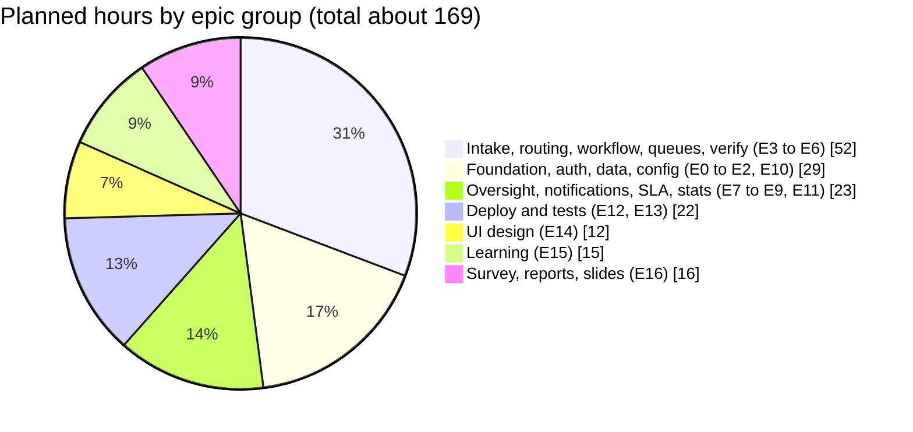

### 2.4 Who owns what (Track split, LOCKED)

| Track | Owner | Owns | Pairs with |
|---|---|---|---|
| **A. Backend core and data** | Dushyant (Lead) | Schema, migrations, seed data, workflow engine, routing, SLA logic, complaint and admin APIs | Dev (Spring) |
| **B. Flutter app and UX** | Yash | Design system, Figma and AI-generated screens, all Flutter screens, state, API integration, usability test | Dushyant (API contract) |
| **C. Platform and quality** | Dev | Docker, CI, hosting, auth and security, attachments and storage, notifications, tests, synthetic data, report and weekly reports | Dushyant (auth), Yash (APK and web hosting) |

**Estimated hours by person** (see 2.3 for the epic list): Dushyant about 52, Yash about 54, Dev about 63 including the shared report work. If Dev is over capacity, Yash takes the survey and slides.

### 2.5 How decisions are made

- **Day to day:** the owner of a track decides inside the track.
- **Cross-track:** discuss in the group chat. If not settled in 24 hours, the **Lead (Dushyant) decides**, writes the decision in Section 11 or the decision register, and everybody follows.
- **Scope:** only the three of you together may add scope, and every addition must remove an equal-sized item.
- **Disagreements are normal.** The rule is *disagree, write the reason, then commit*. No silent rework.

### 2.6 Communication and meetings

| Ritual | When | Length | Purpose |
|---|---|---|---|
| Async check-in | Daily, group chat | 2 minutes | "Did / doing / blocked" in three lines |
| Sync call | Wednesday (half day), plus one weekend call | 30 minutes | Unblock, plan the next days |
| Weekly review | Sunday evening | 45 minutes | Check sprint exit criteria honestly, update the board, update the bible |
| Teach-back swap | Sunday, inside the review | 20 minutes | One person explains a module they did not write |
| Mentor report | Every week (day agreed with the mentor) | 1 page | See template in Appendix D |
| Mentor call | Any time, unannounced | n/a | Be ready: Section 2.7 |

### 2.7 Be ready for the mentor's call

The mentor may call and ask what you have done. Keep a **living one-liner** at the top of the weekly note, and an answer ready to the five questions: what works now, what you are building this week, what is blocking you, what you learned, and what you will demo next. The weekly notes (Appendix D) double as your continuous-evaluation evidence (25% of the grade).

### 2.8 Working agreement (sign it by agreeing in chat)

1. We reply to the group within 24 hours, even if only "busy, back Wednesday".
2. `main` always runs. Nobody pushes straight to it.
3. Every pull request gets a review from a teammate within 24 hours.
4. We do not hide being stuck for more than 90 minutes. Ask, pair, or cut.
5. Nobody ships code they cannot explain.
6. Credit is shared in the commit history and the report; blame is shared in the retrospective.
7. If life intervenes (exams, illness), we say so early and redistribute.

---

## 3. Scope

### 3.1 The demo spine: seven flows that must work end to end

Everything in Semester 1 exists to make these seven flows work on a public deployment with a real phone and a laptop. If a task does not serve one of them, it is a candidate for the cut ladder.

| # | Flow | What the audience sees |
|---|---|---|
| F1 | **Sign up and log in** | A new student registers with email and password, logs in, sees a role-appropriate home |
| F2 | **Report anonymously** | The student picks a category, drills to Block, Floor, Room, adds a photo, submits in under a minute |
| F3 | **Auto-route** | The complaint appears in the correct department's queue with a due time, nobody forwarded it |
| F4 | **Claim without conflict** | Two staff phones tap **Start work**; one wins, the other sees "already taken" |
| F5 | **Resolve with proof** | Staff marks resolved with a note and a proof photo; the timeline records it |
| F6 | **Verify or reopen** | The student is notified; taps **Not fixed**, it returns to the queue; later taps **Fixed** |
| F7 | **Oversight and config** | A supervisor reassigns and sees overdue items; a rule is changed in the database and the next report routes elsewhere |

### 3.2 MVP scope by epic

| Epic | In Semester 1 (MoSCoW) | Notes |
|---|---|---|
| E1 Identity | Must: register, login, refresh, logout, roles. Should: email verification | College-domain allow-list is configurable |
| E2 Directory | Must: location tree, categories, departments (seeded). Could: admin editing screens | Seed by script |
| E3 Intake | Must: category, severity, location, description, photo, anonymous by default. Should: "similar issues" hint | No public feed |
| E4 Routing | Must: first-match rule engine with fallback to Admin Triage | Rules seeded |
| E5 Lifecycle | Must: full state machine, audit events, timeline view | Transitions are a table |
| E6 Staff work | Must: department queue, claim, resolve with proof | Mobile-first, few taps |
| E7 Verification | Must: verify and reopen with reason | Reopen restarts the route |
| E8 Oversight | Should: reassign, reject, overdue list. Could: admin config screens | |
| E9 Notifications | Should: in-app inbox. Could: email via Brevo | Push is S2 |
| E10 SLA | Should: compute and show due time, overdue badge. S2: escalation worker | |
| E11 Stats | Should: three charts (open by status, by department, last 30 days) | Database views |
| E12 Ops | Must: public deploy, keep-alive, APK, backup, demo reset script | |

### 3.3 Explicitly out of Semester 1

| Item | Status | Why |
|---|---|---|
| SLA escalation worker | S2 | Needs time-based testing; due date display is enough for Semester 1 |
| Email and push notifications at scale | S2 (email Could) | In-app inbox proves the outbox pattern |
| "Me too" upvotes, public issue feed | S2 | You said this is not social media; the design leaves room |
| Duplicate detection by text | S2 | Location and category hint is enough |
| ML category suggestion | S2, optional | Honest framing: rule-based first |
| Analytics dashboard beyond three charts | S2 | |
| Google sign-in, college SSO | S2 | Needs college cooperation |
| Admin config screens | Could | Seed scripts do the job |
| Working-hours SLA calendar | S2 | |
| iOS native app, Play Store | CUT | Costs money. iPhones use the web app |
| Chat with the reporter | S2 | Contact-back is a design hook, not a feature |
| Multi-college tenancy | CUT | One college, configurable |

### 3.4 The cut ladder: what to drop when you are behind

Drop from the top. Never drop the Must items.

| Step | Drop | Hours freed |
|---|---|---|
| 1 | E11 charts (replace with a SQL screenshot in slides) | 6 |
| 2 | E9 SLA due display (show nothing, mention in Phase 2) | 3 |
| 3 | E8 in-app notifications (student sees status by pull-to-refresh) | 6 |
| 4 | E7 supervisor reassign and reject (admin does it via SQL during demo) | 8 |
| 5 | "Similar issues" hint | 3 |
| 6 | Email verification | 3 |
| 7 | Photo on resolution (proof by note only) | 3 |

That is 32 hours of cushion, enough to absorb a lost week. The **spine flows F1 to F6 are never cut**.

### 3.5 "Where is the ML?" (answer this before the panel asks)

Phase 1 is rule-based on purpose. Rules are explainable, need no training data, and let an administrator change behaviour with a row edit. A classifier needs labelled data you do not have yet; the survey and the pilot create it. In Semester 2, an optional text classifier will suggest a category as a hint that the user can override. If asked "is this AI?", the answer is: *"No, and that is a design choice. Our novelty is the integrated, config-driven closed loop. ML is a measured Phase 2 extension."*

---

## 4. Users, roles, permissions and anonymity

### 4.1 Personas and the four system roles

The system has **four roles**. Real-world titles map onto them, so the same software works for any college.

| System role | Real-world personas | Does |
|---|---|---|
| **STUDENT** | Student (also usable by any enrolled person who reports) | Reports, tracks own complaints, verifies or reopens |
| **STAFF** | Electrician, plumber, carpenter, housekeeper, mess worker, IT technician, security guard | Works the queue of their department: starts work, resolves with proof |
| **SUPERVISOR** | Department head, Estate officer, **Warden**, HoD, Mess manager, Transport in-charge | Oversees a department **and/or a location scope** (for example "Hostel Block C"), reassigns, rejects, sees overdue items |
| **ADMIN** | Registrar's office, IT admin, system owner | Manages users and configuration, triages unrouted complaints, can reveal a reporter (logged) |

**Warden:** a Supervisor whose *scope* is a location subtree (for example "Boys Hostel" or "Girls Hostel"). Anything reported inside that subtree is visible to that warden. A hostel can also have its own department so staff queues work as normal. No separate role is needed.

**Grievance Committee (sensitive complaints):** a department that only Supervisors (and Admin) can see. See 4.4.

### 4.2 Role capability matrix

| Capability | Student | Staff | Supervisor | Admin |
|---|---|---|---|---|
| Register and log in | Yes | Created by admin | Created by admin | Seeded |
| Create complaint | Yes | No | No | Yes (on behalf) |
| View own complaints | Yes | n/a | n/a | Yes |
| View complaints of own department | No | Yes | Yes | Yes |
| View complaints in own location scope | No | No | Yes | Yes |
| See who reported | **Own only** | **Never** | **Never** | **Reveal, logged** |
| Start work (claim) | No | Yes | Yes | Yes |
| Mark resolved (note and photo) | No | Own claims | Yes | Yes |
| Verify or reopen | **Own only** | No | No | No |
| Reassign department or person | No | No | Yes | Yes |
| Reject (invalid or spam) | No | No | Yes | Yes |
| Triage unrouted complaints | No | No | No | Yes |
| Manage users, categories, rules | No | No | No | Yes |
| View stats | No | No | Own scope | Yes |

### 4.3 Anonymity: say exactly what it means (D8)

**Principle:** the people who *handle* a complaint never learn who *reported* it, unless the reporter chooses to share.

| Question | Answer |
|---|---|
| Does staff see the reporter's name? | **No.** The API never includes the reporter in any response to STAFF or SUPERVISOR |
| Does the reporter still see and control their complaint? | Yes. Ownership is checked by user id on the server |
| Can the system still stop abuse? | Yes. Every complaint stores the reporter id. ADMIN can **reveal** it, which requires a reason and writes a permanent event that other admins can see |
| Can a student choose to be identified? | Yes, an optional checkbox "Share my name and contact with staff" (default off). When on, handlers can see it |
| Does anonymity break photos? | Photos are stripped of EXIF location and device data on the server. Faces and names in photos are the reporter's responsibility; the app warns before upload |
| Is anonymity absolute? | **No.** It is anonymity *from handlers*, not from the system administrator. Say this honestly in the report |
| Will "anonymous" survive a database leak? | **No.** The database stores the reporter id so abuse can be handled. Protection comes from access control and logged reveal, not from cryptography. Say this plainly in the report |

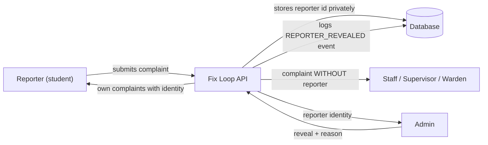

### 4.4 Sensitive complaints (harassment, ragging, discrimination, safety)

Some complaints must not reach ordinary staff. The category table has an `is_sensitive` flag. For a sensitive category:

- Routing always goes to a **restricted department** (for example Grievance Committee), never a general queue.
- Staff-role users **cannot** see the complaint at all; only Supervisors of that department and Admin.
- Photos are disabled by default for sensitive categories.
- No "similar issues" hint is shown.
- The notification text to the reporter never contains the complaint's details.

**OPEN question for the mentor (Dushyant, by Mon 26 Oct):** does the college already have a committee for harassment or ragging complaints (many Indian colleges are required to)? If yes, Fix Loop should *route to them*, not replace them.

### 4.5 Who is allowed to register

- Registration requires an email on the **allowed-domain list** (a configuration row; default the college's domain).
- **OPEN (Dev, ask by Wed 28 Oct):** is the student email domain `bmu.edu.in`? Try signing up with a real student mail and check whether confirmation mails arrive. If the college blocks the verification flow, fall back to a domain check without email verification.
- **Demo-day mode:** because the demo must be usable by "anybody", an admin can switch the allow-list to accept any domain for a limited time, with email verification still required if mail works. Turn it back off after the demo.

---

## 5. Functional requirements

Priority: **M** Must, **S** Should, **C** Could. Phase: 1 this semester, 2 next. Every Must has an **acceptance criterion** that doubles as a test case. IDs are used in tickets, tests and the report.

### E1. Identity and access

| ID | Requirement | Pri | Ph | Acceptance criterion |
|---|---|---|---|---|
| FR-101 | Register with email and password; email must be on the allowed-domain list | M | 1 | Wrong domain is rejected with a clear message; right domain creates a STUDENT |
| FR-102 | Log in; receive short-lived access token and rotating refresh token | M | 1 | Wrong password gives a generic error; right one opens the role home |
| FR-103 | Stay logged in across app restarts; silent refresh | M | 1 | Killing and reopening the app does not ask for the password until the refresh token expires |
| FR-104 | Log out revokes the refresh token | M | 1 | The old refresh token no longer works |
| FR-105 | Staff, supervisor and admin accounts are created by an admin and must change the first password | M | 1 | A seeded admin can create a STAFF user bound to a department |
| FR-106 | Email verification before first login | S | 1 | Unverified account cannot log in; resend works |
| FR-107 | Password reset by email | C | 2 | |
| FR-108 | Role checks on every endpoint | M | 1 | A STUDENT calling a staff endpoint gets 403 |

### E2. Directory (locations, categories, departments)

| ID | Requirement | Pri | Ph | Acceptance criterion |
|---|---|---|---|---|
| FR-201 | Location tree: Campus, Block, Floor, Room (also non-room places: washroom, canteen, ground, gate) | M | 1 | The app shows cascading pickers; selecting a block narrows floors |
| FR-202 | Categories grouped by theme with default severity, photo policy and a sensitive flag | M | 1 | Each category has exactly one policy; washroom categories disable photos |
| FR-203 | Departments with a head (Supervisor) and member Staff | M | 1 | A STAFF user belongs to one department |
| FR-204 | Admin can create and edit the above | C | 1 | Seed scripts suffice in Semester 1; admin screens are Could |

### E3. Complaint intake

| ID | Requirement | Pri | Ph | Acceptance criterion |
|---|---|---|---|---|
| FR-301 | Create complaint: category, location, severity, title, description | M | 1 | All required fields validated on client and server |
| FR-302 | Optional photo(s), max 3, auto-compressed on the phone, checked on the server | M | 1 | A 10 MB photo is compressed before upload; a non-image is rejected |
| FR-303 | Photo policy per category: REQUIRED, OPTIONAL, DISABLED | M | 1 | Submitting without a required photo fails; uploading to a disabled category fails at the API |
| FR-304 | Complaint is anonymous to handlers by default | M | 1 | A STAFF API response never contains reporter data |
| FR-305 | Optional "share my identity with staff" checkbox | C | 1 | When ticked, staff can see name and email |
| FR-306 | Idempotent submit: a retried request creates one complaint | M | 1 | Replaying one request five times creates one complaint |
| FR-307 | Human-readable code such as `FL-2026-000123` | M | 1 | Shown in lists and notifications |
| FR-308 | "Similar open issues" hint at intake (same location and category) | S | 1 | Shows count and status only, never identity or text |
| FR-309 | Draft saved locally if the network drops mid-form | C | 1 | |

### E4. Routing

| ID | Requirement | Pri | Ph | Acceptance criterion |
|---|---|---|---|---|
| FR-401 | Auto-route on creation by priority-ordered rules from the database | M | 1 | A test set of 100 labelled complaints routes at least 90% correctly |
| FR-402 | Rule conditions: category, location subtree, minimum severity; null means "any" | M | 1 | Changing a rule row changes the next routing result without redeploying |
| FR-403 | Fallback rule sends unmatched complaints to Admin Triage and raises an event | M | 1 | A complaint with no matching rule appears in the triage queue |
| FR-404 | Sensitive categories route only to restricted departments | M | 1 | A staff user cannot list or open such a complaint |
| FR-405 | Supervisor or admin can reassign department or person (note required) | S | 1 | Event records old and new assignee |

### E5. Lifecycle

| ID | Requirement | Pri | Ph | Acceptance criterion |
|---|---|---|---|---|
| FR-501 | Statuses: REPORTED, ASSIGNED, IN_PROGRESS, RESOLVED, VERIFIED, REOPENED, REJECTED | M | 1 | |
| FR-502 | Only transitions in the transitions table are legal | M | 1 | Every illegal pair returns an error in a test |
| FR-503 | Every change writes an immutable event with actor, time, from, to | M | 1 | A SQL assertion: every status change has an event |
| FR-504 | Timeline view of events on the detail screen (actor shown as role, not identity, for anonymous reporters) | M | 1 | |
| FR-505 | Notes required on reject, resolve, reopen, reassign | M | 1 | Missing note returns a business-rule error |

### E6. Staff work

| ID | Requirement | Pri | Ph | Acceptance criterion |
|---|---|---|---|---|
| FR-601 | Department queue with tabs: Unclaimed, Mine, Done | M | 1 | |
| FR-602 | "Start work" claims the complaint atomically | M | 1 | 20 parallel claims produce exactly one success |
| FR-603 | Resolve with note and optional proof photo | M | 1 | |
| FR-604 | Staff can release a claim they cannot finish (back to the queue, note required) | S | 1 | |
| FR-605 | Sort by severity then age; overdue badge | S | 1 | |

### E7. Verification and closure

| ID | Requirement | Pri | Ph | Acceptance criterion |
|---|---|---|---|---|
| FR-701 | Reporter confirms the fix (VERIFIED, final) | M | 1 | |
| FR-702 | Reporter can reopen with a reason; complaint is re-routed and the due clock restarts | M | 1 | `reopen_count` increases; timeline shows both events |
| FR-703 | Auto-verify after N days of silence | C | 2 | |
| FR-704 | Reopen limit before supervisor review (for example 3) | C | 2 | |

### E8. Notifications

| ID | Requirement | Pri | Ph | Acceptance criterion |
|---|---|---|---|---|
| FR-801 | Events create outbox rows in the same transaction as the change | M | 1 | Killing the server after commit does not lose a notification |
| FR-802 | In-app inbox with unread count | S | 1 | |
| FR-803 | Email via Brevo (demo) or Gmail SMTP (local) | C | 1 | |
| FR-804 | Retry with backoff; mark FAILED after N attempts | S | 2 | |
| FR-805 | Push notifications | S | 2 | |

### E9. SLA and escalation

| ID | Requirement | Pri | Ph | Acceptance criterion |
|---|---|---|---|---|
| FR-901 | Compute due time from policy at routing time | S | 1 | |
| FR-902 | Show countdown and OVERDUE badge | S | 1 | |
| FR-903 | Escalation worker applies rules on breach, once per level | M | 2 | |
| FR-904 | Working-hours clock | C | 2 | |

### E10. Admin and analytics

| ID | Requirement | Pri | Ph | Acceptance criterion |
|---|---|---|---|---|
| FR-1001 | Admin lists unrouted (triage) complaints and assigns them | S | 1 | |
| FR-1002 | Reveal reporter with reason; logged event visible to admins | S | 1 | The event shows who revealed and why |
| FR-1003 | Three charts: open by status, by department, created per day (30 days) | S | 1 | Backed by database views |
| FR-1004 | MTTR, hotspots, department performance | M | 2 | |
| FR-1005 | Admin screens for categories, locations, rules, SLA, users | C | 1 / M in 2 | |

### E11. Cross-cutting

| ID | Requirement | Pri | Ph | Acceptance criterion |
|---|---|---|---|---|
| FR-1101 | One consistent error format | M | 1 | |
| FR-1102 | API documented by OpenAPI, browsable | M | 1 | |
| FR-1103 | Health endpoint | M | 1 | |
| FR-1104 | Rate limiting on login and complaint creation | S | 1 | 429 after the threshold |
| FR-1105 | Seed and reset script for demo data | M | 1 | One command restores a clean demo state |

---

## 6. Non-functional requirements

| Area | Requirement | How we meet it | How we check it |
|---|---|---|---|
| **Security** | Passwords hashed, tokens short-lived, role checks on every endpoint, input validated | Spring Security, BCrypt, method security, Bean Validation | Negative tests; Section 14 checklist |
| **Privacy** | Reporter identity never reaches handlers; photos stripped of metadata; signed photo links | DTO design, server-side image processing, signed URLs | Tests that inspect responses |
| **Integrity** | No double-claim, no illegal jump, nothing overwritten silently | Optimistic locking, transitions table, append-only events | Concurrency and unit tests |
| **Auditability** | Who did what and when, permanently | `complaint_events` with a database rule that blocks updates | SQL audit assertion |
| **Usability** | Report in under 60 seconds; staff action in 3 taps or fewer | Wizard, large buttons, remembered last block | Timed test with 5 students |
| **Performance** | List screens under 1 second at 1,000 complaints (after cold start) | Indexes, pagination | Load check with seeded data |
| **Availability on free tiers** | Cold start under about 60 seconds, and never during the demo | Keep-alive pings, warm-up before demo, local fallback | Demo-day checklist |
| **Reliability** | Notifications survive restarts | Outbox | Kill test |
| **Maintainability** | A new teammate runs everything in 10 minutes | Docker Compose, README | A teammate tries it fresh |
| **Portability** | Android and any modern browser | Flutter | Tested on one Android phone and Chrome and Safari |
| **Accessibility** | Text 14sp or larger, 48 px touch targets, never colour alone | Design system | Checklist |
| **Observability** | Know when it is down | Health endpoint, uptime pings, request logs with trace ids | Pull-the-plug rehearsal |
| **Compliance mindset** | Handle personal data carefully | Data minimisation, retention rules (9.7) | Section 14.3 |

---

## 7. Technology stack and zero-budget hosting

### 7.1 The stack at a glance

| Layer | Choice | Status | Why in one line |
|---|---|---|---|
| Client | Flutter 3.x (Dart), Material 3 | LOCKED | One codebase for Android and web |
| State management | Riverpod | PROPOSED | Testable, popular, clear data flow for beginners |
| Navigation | go_router with role guards | PROPOSED | Declarative redirects by role |
| HTTP | dio with interceptors | PROPOSED | Token refresh and error mapping in one place |
| Backend | Java 21, Spring Boot 3, Gradle or Maven | LOCKED | Team knows Java; built-in security, transactions, scheduling |
| Persistence | Spring Data JPA, with plain SQL for the hot paths | PROPOSED | JPA for CRUD, SQL for claim and routing |
| Migrations | Flyway | PROPOSED | The database changes only through versioned files in Git |
| Database | PostgreSQL 16 | LOCKED | Constraints, jsonb, `SKIP LOCKED`, views |
| Photo storage | S3-compatible: Supabase Storage (cloud), MinIO (local) | PROPOSED | Same client library for both |
| Auth | Own JWT (access + rotating refresh) | PROPOSED | No third-party dependency to fail on demo day |
| Scheduling | Spring `@Scheduled` with database locks | PROPOSED | One app, no extra worker to host |
| Email | Brevo free tier (demo), Gmail SMTP (local) | PROPOSED | Free, no card |
| API contract | OpenAPI via springdoc, Swagger UI | PROPOSED | The contract between tracks |
| Tests | JUnit 5, Testcontainers, Flutter widget tests | PROPOSED | Real Postgres in tests |
| Container | Docker, Docker Compose | LOCKED | Everyone runs the same stack |
| CI | GitHub Actions | LOCKED | Free for student repos |
| Observability | Spring Actuator health, external uptime ping | PROPOSED | Enough |

### 7.2 Why Flutter (and not React Native or a plain web app)

| Option | For | Against | Verdict |
|---|---|---|---|
| **Flutter** | One codebase gives an Android app and a web app; consistent UI; fast iteration with hot reload; strong Material 3 | New language for all three; web bundles are large; photo picking differs on web | **Chosen** (LOCKED) |
| React Native | JavaScript is familiar to many | Web needs a separate story; not your choice | Not chosen |
| Plain responsive web (PWA) | One technology, instant deploy | Less "app-like" for the demo; camera integration is weaker | Fallback if Flutter blocks us |
| Native Android (Kotlin) | Best Android | Android only; extra language | No |

**Honest risks of Flutter for you:** the Dart learning curve; Flutter web is heavy and slower on first load; the camera and file picker behave differently on web and Android. **Mitigation:** the 3-day ramp (Section 18.4), mock data first, a hallway test on web and Android in week 1, and the PWA fallback (Section 20).

**Where each client is used:** the **Android APK** for students and staff on phones; the **web build** for supervisors and admins on laptops and for iPhones. Both talk to the same API.

### 7.3 Why Java and Spring Boot (and the escape hatch)

| Criterion | Spring Boot (Java 21) | NestJS (TypeScript) | FastAPI (Python) |
|---|---|---|---|
| Matches the team's current skills | **Yes** (Dev uses Java now, Yash and Dushyant know it) | No | No |
| Transactions and optimistic locking | Built in | Via an ORM | Via an ORM |
| Scheduling | Built in | Library | Library |
| Security (JWT, roles, method rules) | Mature but steep | Guards | Dependencies |
| Migrations | Flyway | ORM migrations | Alembic |
| RAM on free hosting | **Heavy** (needs JVM tuning on 512 MB) | Light | Light |
| Viva value | High: explainable layers | Medium | Medium |

**Decision:** Spring Boot (LOCKED once ratified Monday). **Escape hatch (ADR-002):** if by **Sunday 1 Nov** nobody can get a secured endpoint, a migration and a test running on a clean machine, switch to NestJS and record why. After 1 Nov, never switch.

**The honest cost of Spring:** RAM. Render's free tier gives about 512 MB, which a default JVM will exceed. The plan: cap the heap, disable unused auto-configuration, keep the container image slim, and prefer Plan B (a VM) if memory still bites.

### 7.4 PostgreSQL 16

- **Constraints are your friend:** checks on status values, foreign keys, unique keys on idempotency and codes.
- **`jsonb`** for flexible event payloads.
- **Row locking with `SKIP LOCKED`** for background scans.
- **Views and materialised views** for analytics, so the dashboards are SQL, not application code.
- **`pg_trgm`** (Phase 2) for text similarity.
- Timestamps are `timestamptz` in UTC; the app shows IST.

### 7.5 Hosting and infrastructure: the zero-budget reality

> Free tiers, limits and Student Pack offers change often. **Re-verify each item below on the provider's official page on the day you sign up.** What follows is the plan and the checklist, not a promise.

**The constraint:** strictly zero rupees, no card. The result must be public so anyone can use it.

#### Plan A (default for the Semester 1 demo): free managed tiers

| Component | Provider (candidate) | What to check before relying on it |
|---|---|---|
| API (Spring Boot in Docker) | Render free web service | RAM limit; **idle spin-down and cold start time**; monthly hour limit |
| Database | Supabase free project (Postgres) | Storage cap; **pause after inactivity**; connection limits; use the pooled connection string |
| Photo storage | Supabase Storage | Storage and bandwidth caps; public vs signed URLs |
| Flutter web | A free static host (for example Cloudflare Pages, GitHub Pages or Netlify) | SPA routing rule so deep links work; HTTPS |
| Android APK | GitHub Releases | File size limit; install instructions for "unknown sources" |
| Keep-alive | A free uptime monitor or cron pinger hitting the health endpoint | Ping interval vs the host's sleep rule |
| Email (Could) | Brevo free tier | Daily sending cap; sender verification |

**Cold-start mitigation:** (1) keep-alive ping every few minutes; (2) a "warm-up" request 10 minutes before any demo; (3) the app shows a friendly "waking the server, about 30 seconds" screen instead of an error.

**Supabase note:** use Supabase as plain managed Postgres and storage. Do **not** adopt its auth and row-level policies; the app has its own auth, and mixing two models is how weeks disappear.

#### Plan B (upgrade for stability and the Semester 2 pilot): one student VM with Docker Compose

| Option | Strength | Catch |
|---|---|---|
| **Azure for Students** | Credit for verified students, **no card required** (verify), enough for a small VM for months | Credit expires; set a spending alert; region and quota limits |
| **GitHub Student Developer Pack** | Bundle of offers (cloud credits, a free domain, IDEs, tools); check which are active | Many need verification or a card; read the terms |
| **Oracle Cloud Always Free** | Generous VM | Often needs a card for sign-up; capacity varies; not "no card" |
| **College server or lab VM** | Best for a real pilot, data stays on campus | Needs approval; ask via the mentor |

On Plan B, one VM runs the API, Postgres, MinIO and a reverse proxy with HTTPS (Docker Compose). It is closer to your local setup and avoids cold starts, but you now administer a server (updates, backups, firewall). **Decide by Wed 28 Oct (Dev):** Plan A for the demo, Plan B trial in parallel, switch only if Plan A fails the cold-start test.

#### Domain and HTTPS

HTTPS is mandatory (login tokens). Free hosts give it. A custom domain is optional; the Student Pack may offer one for a year, but a `*.onrender.com`-style URL is fine for the demo.

### 7.6 Everything else, decided

| Concern | Decision |
|---|---|
| Source control | GitHub, one monorepo (D15) |
| Task board | GitHub Projects, columns Backlog, This sprint, Doing, Review, Done |
| API testing | Swagger UI first; Bruno or Postman for saved collections |
| DB client | DBeaver or pgAdmin |
| Diagrams | Mermaid in this bible; draw.io or Excalidraw for slides |
| Design | Figma (education plan) plus AI generators (Section 12.8) |
| IDEs | IntelliJ IDEA (Student Pack) for Java; Android Studio or VS Code for Flutter |
| Local email catcher | Mailpit |
| Image processing (server) | Strip metadata and re-encode on upload; set size limits |
| Rate limiting | An in-memory bucket per user and IP, adequate for one instance |
| Time zone | Store UTC, display IST |
| Locale | English only |

---

## 8. System architecture

### 8.1 Design principles (the tie-breakers)

When two designs both work, pick the one that satisfies these in order:

1. **The simplest thing that keeps the loop closed.** A boring monolith beats a clever distributed system.
2. **Rules live in data, not code.** If an administrator might change it, it is a table row.
3. **The database is the source of truth and the referee.** Constraints, versions and locks protect you from your own bugs.
4. **Every change is an event.** If it is not in `complaint_events`, it did not happen.
5. **Privacy is structural.** The reporter's identity is removed in the response shape, not hidden by the UI.
6. **Design for the free tier.** Cold starts, small memory, sleeping databases are normal conditions, not edge cases.
7. **Explainable beats impressive.** Every person must be able to explain every box.

### 8.2 Context diagram: who talks to what

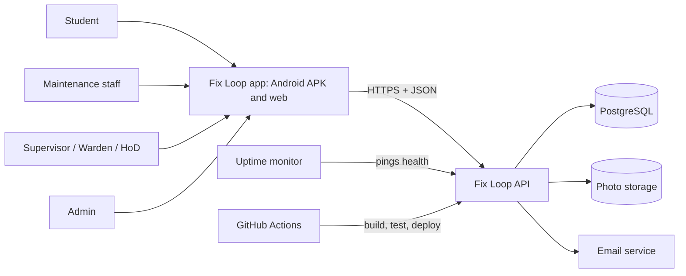

### 8.3 Container diagram: the real architecture

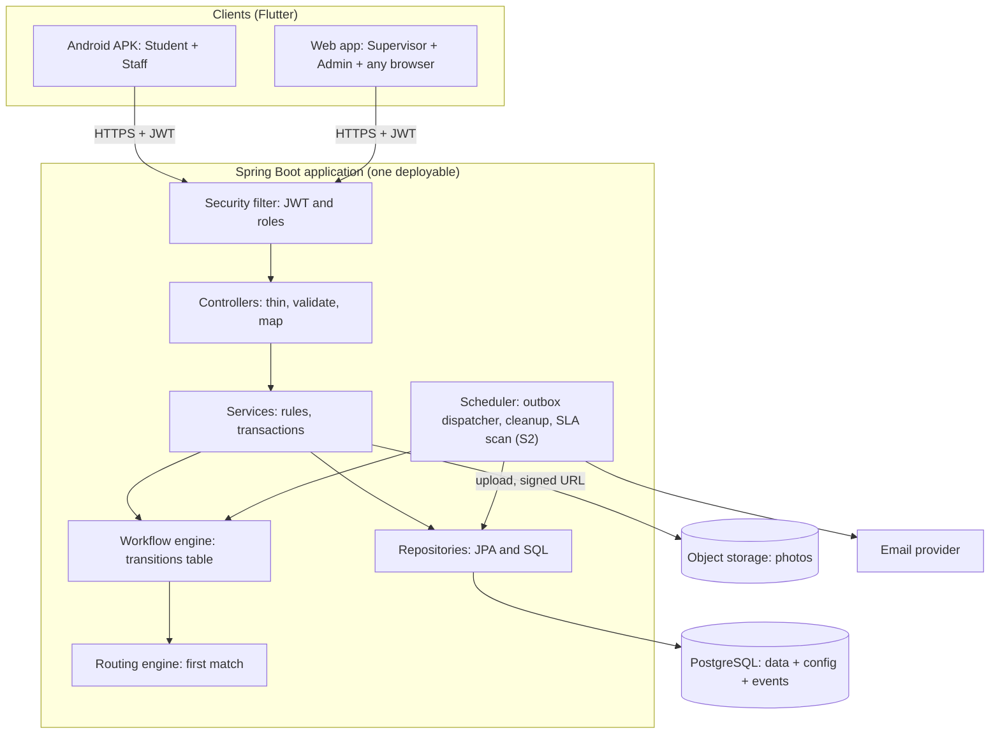

**How to read it:** clients only talk to the API. Controllers never contain business rules. Services own transactions. **Status changes only happen through the workflow engine**, whether a human clicked or the scheduler acted. That single rule makes the audit trail trustworthy.

### 8.4 Backend package layout (package by feature)

```text
com.fixloop
  common/        error format, trace id, clock, ids, pagination, config
  auth/          register, login, tokens, security filter, password rules
  directory/     locations, categories, departments (mostly read)
  complaint/     create, query, detail, similar-issues hint
  workflow/      state machine, transitions, claim, events
  routing/       rule evaluation, fallback
  attachment/    validate, strip metadata, store, signed links
  notification/  outbox writer, dispatcher, inbox
  sla/           due-date calculation, scan (S2)
  stats/         read-only views for charts
  admin/         users, config, triage, reveal reporter
```

**Rules of the house**

1. A package may call another package's **service**, never its repository or tables.
2. A controller has no `if` statements about business rules; it validates input, calls one service method, maps the result.
3. A service method that changes data is one transaction.
4. **Only `workflow` writes the status column and the events.** Everyone else asks workflow.
5. DTOs for requests and responses are separate classes from the persistence entities. A response class that could leak the reporter simply does not have the field.
6. Every public method has a name that reads like a sentence (`claimComplaint`, not `process`).

### 8.5 Request lifecycle: what happens on creating a complaint

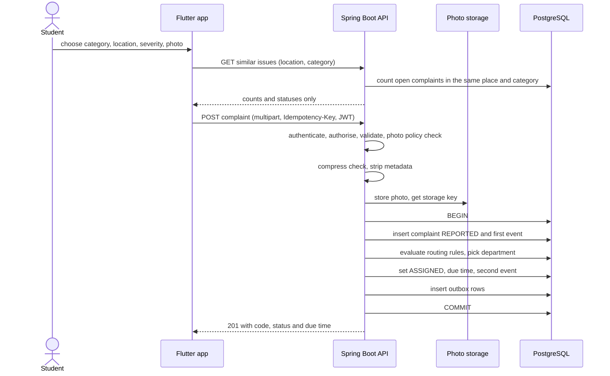

If the transaction fails after the photo upload, the stored object is orphaned; a nightly cleanup removes objects with no attachment row older than 24 hours.

### 8.6 Claim and resolve: concurrency in one picture

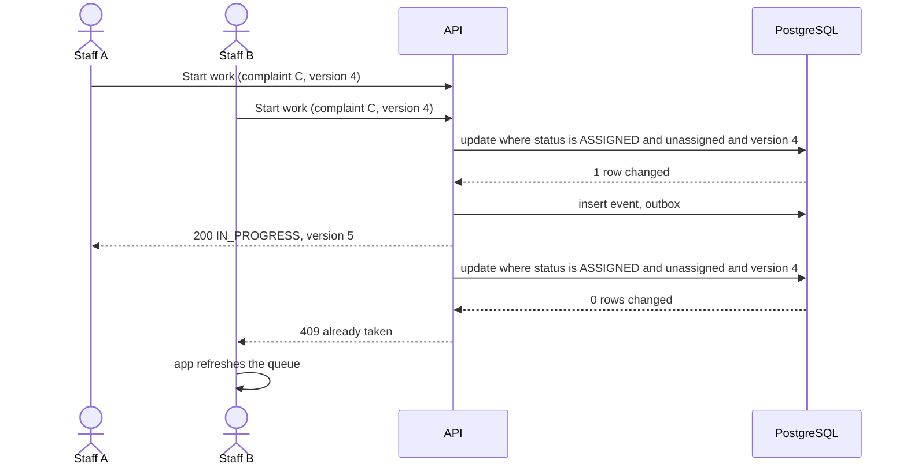

### 8.7 Verification and reopen

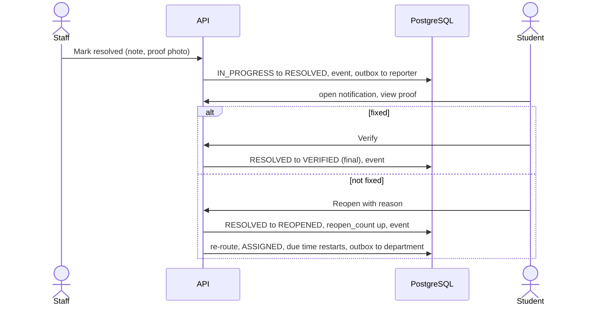

### 8.8 SLA sweep (Semester 2, designed once now)

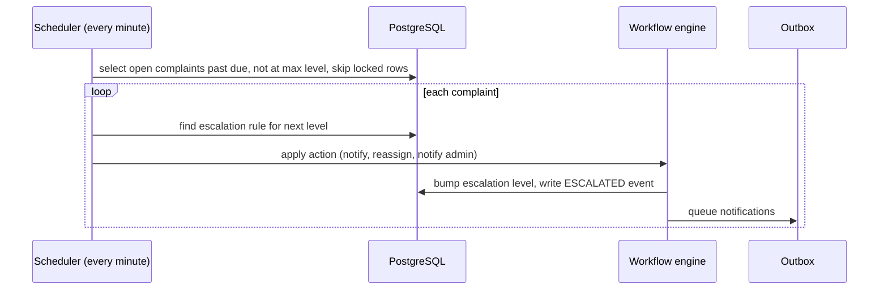

Because the scan reads stored due times rather than in-memory timers, a restart loses nothing. The escalation level counter prevents double escalation if two instances run.

### 8.9 Login and token refresh

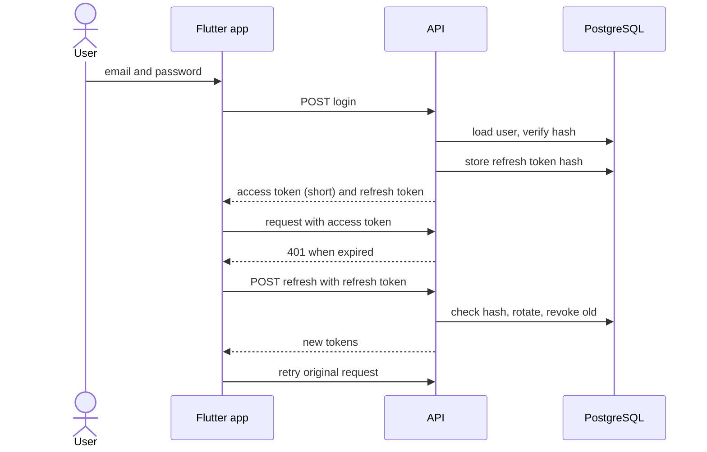

### 8.10 Failure modes and what happens (copy this table into the report)

| Situation | What could go wrong | Mechanism | How we prove it |
|---|---|---|---|
| Two staff tap Start work together | Both think they own it | Optimistic locking: the update only succeeds when the version and unassigned condition still hold; loser gets 409 | Concurrency test: 20 threads, exactly 1 wins |
| Illegal status jump | Corrupt lifecycle | Transitions table checked in workflow with role and note rules | Test every allowed and forbidden pair |
| Student double-taps Submit or the network retries | Duplicate complaint | Idempotency key stored with the complaint | Replay test |
| No routing rule matches | Complaint lost | Fallback rule to Admin Triage plus an event | Test with an unknown category |
| Crash between saving and notifying | Lost notification | Outbox rows commit with the change | Kill and restart test |
| Email provider down | Silent drop | Dispatcher retries with backoff, marks FAILED (visible to admin) | Bad SMTP test |
| SLA scanner crashes or runs twice | Missed or double escalation | Query on stored due time, row locks, level counter | Run twice, one event |
| Stale client edits an old copy | Lost update | Every write carries the version the client saw | Old-version test |
| Token expires mid-session | Random logouts | Refresh token rotation with an interceptor | Interceptor unit test |
| Abuse and spam | Fake or flooding complaints | Domain allow-list, rate limit, admin reject, reporter reveal | Rate limit test |
| Non-image or huge upload | Storage abuse | Type and size checks, server re-encode | Negative tests |
| Free host sleeps | Demo fails on cold start | Keep-alive, warm-up, friendly loading screen, local fallback | Rehearsal |
| Free database pauses | Whole app down | Keep-alive that touches the database, calendar reminder | Rehearsal |
| Clock confusion | Due time off by hours | UTC everywhere, IST only at display | Test around midnight |
| Bad deploy | Broken demo | CI must pass, health check after deploy, rollback to the last image | Practice a rollback |

### 8.11 Scaling story (one slide, honest numbers)

A campus of a few thousand users creates tens to a few hundred complaints a day. One small instance with a properly indexed database comfortably handles that. The honest statement for the panel: *"We designed for correctness at campus scale, not internet scale. The monolith can be split along the module boundaries if load ever demands it."* Do not quote numbers you have not measured; measure with the seeded data (Section 15).

---

## 9. Data model

### 9.1 The shape of it, in words

- **Core data:** users, departments, locations, categories, complaints, attachments.
- **History:** `complaint_events`, append-only, the audit trail and the source of analytics.
- **Configuration:** routing rules, SLA policies, escalation rules, status transitions, settings. This is the novelty: behaviour is data.
- **Messaging:** `notifications_outbox`, which is also the in-app inbox.
- **Security:** refresh tokens.

All primary keys are UUIDs. All times are `timestamptz` in UTC. Names use snake_case. Anything that changes a complaint also writes an event in the same transaction.

### 9.2 ER diagram (core)

```mermaid
erDiagram
  DEPARTMENTS ||--o{ USERS : employs
  DEPARTMENTS ||--o{ ROUTING_RULES : target_of
  DEPARTMENTS ||--o{ COMPLAINTS : handles
  LOCATIONS ||--o{ LOCATIONS : parent_of
  LOCATIONS ||--o{ COMPLAINTS : occurs_at
  LOCATIONS ||--o{ ROUTING_RULES : scoped_by
  CATEGORIES ||--o{ COMPLAINTS : classifies
  CATEGORIES ||--o{ ROUTING_RULES : matched_by
  CATEGORIES ||--o{ SLA_POLICIES : timed_by
  USERS ||--o{ COMPLAINTS : reports
  USERS ||--o{ COMPLAINTS : works_on
  COMPLAINTS ||--o{ COMPLAINT_EVENTS : logs
  COMPLAINTS ||--o{ ATTACHMENTS : has
  USERS ||--o{ COMPLAINT_EVENTS : acts
  USERS ||--o{ NOTIFICATIONS_OUTBOX : receives
  USERS ||--o{ REFRESH_TOKENS : holds
  SLA_POLICIES ||--o{ ESCALATION_RULES : escalates_with
  COMPLAINTS {
    uuid id PK
    text code
    uuid reporter_id FK
    uuid category_id FK
    uuid location_id FK
    uuid department_id FK
    uuid assigned_to FK
    text status
    text severity
    boolean share_identity
    timestamptz sla_due_at
    int escalation_level
    int reopen_count
    int version
  }
  COMPLAINT_EVENTS {
    uuid id PK
    uuid complaint_id FK
    uuid actor_id FK
    text actor_role
    text event_type
    text from_status
    text to_status
    jsonb payload
    timestamptz created_at
  }
  LOCATIONS {
    uuid id PK
    uuid parent_id FK
    text type
    text name
    text path
  }
  ROUTING_RULES {
    uuid id PK
    int priority
    uuid category_id FK
    uuid location_scope_id FK
    text min_severity
    uuid department_id FK
    boolean active
  }
```

### 9.3 The state machine (draw this on the board in the viva)

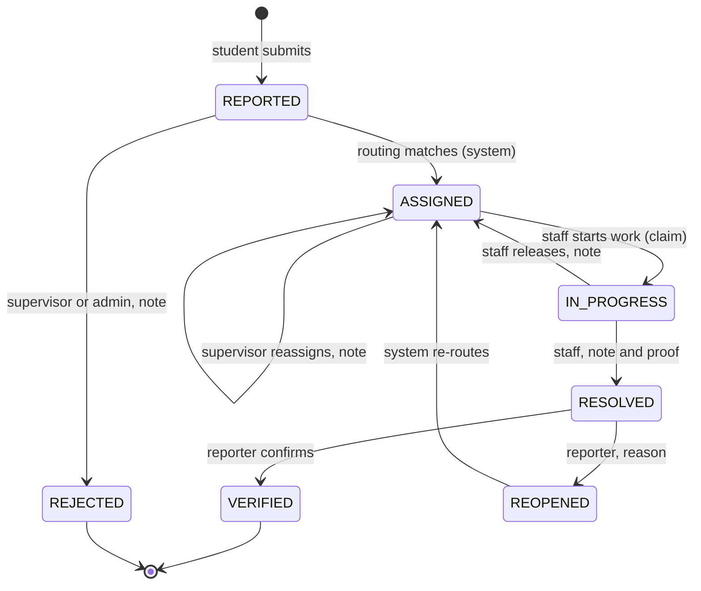

| Status | Meaning | Terminal? |
|---|---|---|
| REPORTED | Saved, not yet routed | No (momentary) |
| ASSIGNED | In a department queue; optionally to a named person | No |
| IN_PROGRESS | A staff member owns it | No |
| RESOLVED | Staff say it is fixed; waiting for the reporter | No |
| VERIFIED | Reporter confirmed; closed | **Yes** |
| REOPENED | Reporter says it is not fixed; momentary before re-routing | No |
| REJECTED | Invalid, duplicate or spam | **Yes** |

### 9.4 Table specifications

*(Column lists are the contract for Flyway migrations. Types are indicative. "Req" means NOT NULL.)*

**users**

| Column | Type | Req | Notes |
|---|---|---|---|
| id | uuid | yes | Primary key |
| email | text | yes | Unique, lower-cased; must match allowed domains for students |
| password_hash | text | yes | BCrypt hash, never returned |
| full_name | text | yes | |
| role | text | yes | One of STUDENT, STAFF, SUPERVISOR, ADMIN |
| department_id | uuid | no | Required for STAFF, optional for SUPERVISOR |
| scope_location_id | uuid | no | For wardens and area supervisors: the subtree they oversee |
| email_verified | boolean | yes | Default false |
| must_change_password | boolean | yes | True for admin-created accounts |
| active | boolean | yes | Soft disable |
| created_at, last_login_at | timestamptz | | |

**departments:** id, name (unique), code (unique), kind (SERVICE or RESTRICTED), head_user_id (nullable), active. A RESTRICTED department (for example Grievance Committee) is only visible to its own supervisors and admins.

**locations:** id, parent_id (nullable for the campus root), type (CAMPUS, BLOCK, FLOOR, ROOM, AREA), name, path (materialised path such as `/1/4/9/`), active. Indexed on path for subtree queries. AREA covers non-room places such as a washroom, canteen, ground, gate.

**categories:** id, name, theme (for example INFRASTRUCTURE, HOSTEL, MESS, IT, TRANSPORT, SAFETY, ACADEMIC, ADMINISTRATIVE, SENSITIVE, OTHER), default_severity, photo_policy (REQUIRED, OPTIONAL, DISABLED), is_sensitive (boolean), active, sort_order.

**complaints**

| Column | Type | Req | Notes |
|---|---|---|---|
| id | uuid | yes | PK |
| code | text | yes | Unique, human form `FL-2026-000123` from a sequence |
| reporter_id | uuid | yes | **Never exposed to handlers** |
| share_identity | boolean | yes | Default false |
| category_id, location_id | uuid | yes | |
| title | text | yes | Length limits enforced |
| description | text | no | Length limit |
| severity | text | yes | LOW, MEDIUM, HIGH, CRITICAL |
| status | text | yes | Check constraint to the seven statuses |
| department_id | uuid | no | Set by routing |
| assigned_to | uuid | no | The staff member who claimed |
| sla_due_at | timestamptz | no | Computed at routing |
| escalation_level | int | yes | Default 0 (S2 use) |
| reopen_count | int | yes | Default 0 |
| version | int | yes | **Optimistic lock counter**; every update increments it |
| idempotency_key | text | no | Unique per reporter |
| created_at, updated_at, resolved_at, verified_at | timestamptz | | |

**complaint_events:** id, complaint_id, actor_id (nullable for system), actor_role (STUDENT, STAFF, SUPERVISOR, ADMIN, SYSTEM), event_type (CREATED, ROUTED, ROUTING_FALLBACK, REASSIGNED, CLAIMED, RELEASED, RESOLVED, VERIFIED, REOPENED, REJECTED, ESCALATED, NOTE, REPORTER_REVEALED), from_status, to_status, payload (jsonb: note, old and new assignee, rule id), created_at. **Append-only:** a database rule or trigger rejects updates and deletes. Indexed on (complaint_id, created_at).

**attachments:** id, complaint_id, event_id (null for the original report), kind (REPORT or RESOLUTION), storage_key, mime_type, size_bytes, created_at. Only keys in the database, never bytes.

**status_transitions (config):** from_status, to_status, allowed_roles (list), requires_note (boolean), system_only (boolean). Seed: see 10.4.

**routing_rules (config):** id, priority (lower wins), category_id (nullable = any), location_scope_id (nullable = anywhere), min_severity (nullable), department_id, active, note. The fallback rule has priority 9999 and all conditions null.

**sla_policies (config):** id, category_id, severity, response_minutes, resolve_minutes. Unique on (category_id, severity). A default policy covers missing pairs.

**escalation_rules (config, S2):** id, sla_policy_id, level, after_minutes_overdue, action (NOTIFY_SUPERVISOR, REASSIGN, NOTIFY_ADMIN), target_role.

**settings (config):** key, value. Examples: `allowed_email_domains`, `max_photos`, `max_photo_mb`, `reopen_limit`, `auto_verify_days`, `demo_mode_open_signup`.

**notifications_outbox:** id, user_id, channel (IN_APP, EMAIL, PUSH), type, payload (jsonb), status (PENDING, SENT, FAILED), attempts, next_attempt_at, created_at, sent_at, read_at. Doubles as the in-app inbox.

**refresh_tokens:** id, user_id, token_hash, expires_at, revoked_at, replaced_by.

### 9.5 Indexes that matter

| Index | Serves |
|---|---|
| complaints (department_id, status, created_at desc) | Staff queue |
| complaints (reporter_id, created_at desc) | "My complaints" |
| complaints (status, sla_due_at), partial where open | SLA display and scan |
| complaints (location_id, category_id), partial where open | Similar-issues hint |
| complaint_events (complaint_id, created_at) | Timeline |
| notifications_outbox (status, next_attempt_at) | Dispatcher |
| locations (path) with prefix matching | Subtree queries |
| complaints (reporter_id, idempotency_key) unique | Idempotent submit |

### 9.6 Analytics as views, not application code

Build three SQL views for Semester 1 and let the app read them:

1. **Open complaints by status** (count per status).
2. **Open complaints by department** (count per department, with overdue count).
3. **Created per day, last 30 days.**

In Semester 2 add materialised views refreshed nightly: mean time to resolution by department and category; hotspots (locations with repeated complaints in a category); reopen rate by department; SLA breach rate.

### 9.7 Data lifecycle and retention

| Data | Rule (proposed) |
|---|---|
| Complaints and events | Keep for the academic year; archive or anonymise after (decide with the college) |
| Photos | Delete or archive after the complaint is closed for a set period; orphan cleanup nightly |
| Refresh tokens | Delete after expiry |
| Outbox | Delete SENT rows after 30 days |
| Demo and synthetic data | Mark clearly; never mix with real data (separate environment) |

### 9.8 Seed data: this is what makes the demo real

| Seed | Content | Owner |
|---|---|---|
| Locations | The real campus tree: blocks, floors, representative rooms, washrooms, canteen, hostels, ground, gates | Dushyant with a campus walk |
| Departments | Electrical, Plumbing and Sanitation, Housekeeping, Carpentry and Civil, IT and Network, Hostel Management, Mess and Canteen, Security, Transport, Admin Triage, Grievance Committee (restricted) | Dushyant |
| Categories | About 20 across the themes in 9.4 | Yash (UX wording), Dushyant |
| Routing rules | One rule per category and a few location overrides (for example hostel washrooms go to Hostel Management) | Dushyant |
| SLA policies | Rough targets by severity (get real numbers from the maintenance office) | Dev |
| Transitions | The table in 10.4 | Dushyant |
| Users | 5 students, 3 staff across 2 departments, 2 supervisors (one warden), 1 admin | Dev |
| Synthetic complaints | 500 to 1,000 realistic rows for load, charts and routing accuracy; 100 labelled | Dev |

---

## 10. Core algorithms and rules

### 10.1 Priority: impact times urgency (no magic)

Severity is chosen by the reporter from four labelled options with plain-language definitions shown in the app:

| Severity | Plain meaning | Example |
|---|---|---|
| LOW | Annoying, no effect on use | Scratched bench |
| MEDIUM | Reduces comfort or use | AC weak in a classroom |
| HIGH | Blocks normal use | Washroom blocked, no water |
| CRITICAL | Safety risk or health risk | Exposed wiring, lift stuck, fire hazard |

CRITICAL also notifies the supervisor of the department immediately. Staff queues sort by severity, then age.

### 10.2 Routing: first match wins

1. Load active rules ordered by priority ascending.
2. A rule matches when **all** its non-null conditions hold: the category equals; the complaint's location path starts with the rule's location scope path; the complaint's severity is at least the rule's minimum.
3. The first matching rule gives the department. Stop.
4. If the category is sensitive, only rules that point to a RESTRICTED department are considered.
5. If nothing matches, the fallback rule (priority 9999) assigns **Admin Triage** and a ROUTING_FALLBACK event is written.

Why this is strong: adding a department or changing who handles Block C is a row edit; the algorithm is easy to explain and to test; routing accuracy is measurable on a labelled set (target 90% or better).

### 10.3 SLA due time

At routing time, look up the SLA policy for (category, severity); if absent, use the default policy. `due = created_at + resolve_minutes` (24x7 in Semester 1). On reopen the clock restarts. Overdue means now is past the due time and the complaint is not RESOLVED, VERIFIED or REJECTED. In Semester 2 add business-hours calendars.

### 10.4 Transitions table (seed for `status_transitions`)

| From | To | Allowed | Note required | System only |
|---|---|---|---|---|
| (none) | REPORTED | Student, Admin | No | No |
| REPORTED | ASSIGNED | System, Supervisor, Admin | No | No |
| REPORTED | REJECTED | Supervisor, Admin | Yes | No |
| ASSIGNED | ASSIGNED (reassign) | Supervisor, Admin | Yes | No |
| ASSIGNED | IN_PROGRESS | Staff of that department, Supervisor | No | No |
| IN_PROGRESS | ASSIGNED (release) | Assigned staff, Supervisor | Yes | No |
| IN_PROGRESS | RESOLVED | Assigned staff, Supervisor | Yes | No |
| RESOLVED | VERIFIED | The reporter only | No | No |
| RESOLVED | REOPENED | The reporter only | Yes | No |
| REOPENED | ASSIGNED | System, Supervisor | No | Yes |
| RESOLVED | VERIFIED (auto, after N days) | System | No | Yes (S2) |

**The workflow engine's one public method**, in words: *change complaint X by actor Y using action Z, with note N, expecting version V.* It looks up the allowed row for (current status, target), checks the actor's role and ownership, checks the note rule, checks the version, then in one transaction updates the complaint, writes the event, writes the outbox rows. Errors map cleanly: wrong role 403, missing note 422, stale version 409.

### 10.5 Claiming (optimistic locking, in words)

*Set the assignee to me and the status to IN_PROGRESS, but only where the complaint is still ASSIGNED, has no assignee, and still has the version I read.* If zero rows change, someone else won, the API answers 409, and the app shows "already taken" and refreshes. In JPA this is the version field. No application-level locks.

### 10.6 Similar-issues hint (Semester 1)

When category and location are chosen, count open complaints with the same category in the same room, else the same floor. Show only the **count and the most common status** ("2 similar open issues, being worked on"). Never show text or identity (D8, D9). The student can still submit; this is a hint, not a block. Semester 2 may add text similarity with `pg_trgm`.

### 10.7 Reporter reveal (break-glass)

Admin selects "Reveal reporter", must enter a reason of at least a minimum length; the system writes REPORTER_REVEALED with the admin id and reason, and only then returns the reporter's name and email for that one complaint. Other admins can see the event. This is the control that makes anonymity defensible.

### 10.8 Idempotent submit

The client generates a random key per submission attempt. The server stores it with the complaint (unique per reporter). A repeated request with the same key returns the original complaint, not a new one.

---

## 11. Architecture Decision Records (ADRs)

Format: decision, alternatives, why, when we would reverse it.

| ADR | Decision | Alternatives | Why | Reverse when |
|---|---|---|---|---|
| 001 | Modular monolith | Microservices | Three people, five weeks; one deployable is debuggable | Only if the ML service becomes a separate runtime in S2 |
| 002 | Spring Boot (Java 21) | NestJS, FastAPI | Team knows Java; built-in security, transactions, scheduling | If by Sun 1 Nov nobody can run a secured, migrated, tested endpoint on a clean machine |
| 003 | Flutter for Android and web | React Native, PWA | Chosen; one codebase | If web photo upload cannot be made to work by Sun 8 Nov, ship the Android APK and a minimal web admin only |
| 004 | Rules in database | Rules in code | Admin changes behaviour with no deploy; explainable | Never in this project |
| 005 | Transitions as a table | If-else in code | One place to read, test and change | Never |
| 006 | Append-only events | Update-in-place with history flags | Audit, analytics, replay | Never |
| 007 | Optimistic locking | Pessimistic row locks | Simple, scales, matches the HTTP model | If contention is heavy (it will not be) |
| 008 | Outbox for notifications | Send inside the request | Survives crashes and provider outages | Never |
| 009 | Own JWT auth | Supabase Auth, Firebase Auth, SSO | Fewer moving parts on demo day; one security model | In S2 add college SSO if the college cooperates |
| 010 | Photos through the API | Direct to storage with signed upload | One fewer moving part for beginners | If API memory or time becomes the bottleneck |
| 011 | Anonymous by default, admin reveal logged | Open identity, or fully anonymous | Matches the product intent and keeps abuse handling possible | If the college requires identity |
| 012 | No public feed | Social features | Not a social platform; privacy | S2, only as opt-in, never exposing identity |
| 013 | Plan A free tiers, Plan B VM | Pay for hosting | Strict zero budget | If Plan A fails the cold-start rehearsal |
| 014 | Supabase used only as Postgres and storage | Use its auth and policies | One security model | Never |
| 015 | Seed scripts for config in S1 | Admin UI first | Saves about 12 hours | Admin UI in S2 |
| 016 | English only | i18n | Scope | S2 if the pilot needs Hindi |
| 017 | Four roles with scopes | Many roles | Generic for any college | If the college needs distinct permission sets |
| 018 | Sensitive category class | Treat all alike | Real colleges have harassment and ragging obligations | Never |

---

## 12. Client architecture (Flutter) and UI design

### 12.1 Project structure (feature-first)

```text
apps/mobile/lib/
  main.dart
  core/          theme and tokens, router and guards, api client, error mapping, config
  shared/        reusable widgets: status chip, severity chip, complaint card,
                 timeline tile, photo picker, empty and error states, loading skeleton
  features/
    auth/          data (api, dto)  domain (models, repository)  presentation (screens, providers)
    complaints/    student flows: wizard, my complaints, detail, verify or reopen
    queue/         staff and supervisor: queue, detail actions, reassign, reject
    admin/         triage, reveal reporter, stats, (config screens: Could)
    notifications/ inbox
```

Each feature has three layers: **data** (API calls and DTOs), **domain** (models and a repository interface), **presentation** (screens and state providers). Screens never call the HTTP client directly. This lets one person work on a feature without touching the others, and lets you swap the real repository for a **mock repository** (critical for Week 1, see 12.4).

### 12.2 How to build the app, in order (what to code)

Build in this order so there is always something runnable:

| Step | What to build | Done when |
|---|---|---|
| 1 | Theme and tokens (colours, type, spacing), app shell, navigation with a fake role switcher | You can open Student, Staff, Supervisor and Admin homes with fake data |
| 2 | Shared widgets: status chip, severity chip, complaint card, timeline tile, empty and error states | A gallery screen shows every widget in every state |
| 3 | Mock repository with sample complaints | All screens work offline with fake data |
| 4 | Student flow screens: home list, wizard (4 steps), review, detail with timeline | A fake complaint can be "created" and appears in the list |
| 5 | Staff screens: queue tabs, detail with big action buttons, resolve sheet | Fake claim and resolve update the list |
| 6 | Supervisor and admin screens: overdue list, reassign sheet, triage list | |
| 7 | **Swap mock for real repository**, one feature at a time, starting with auth | Login works against the deployed API |
| 8 | Photo upload with compression | A real photo reaches storage |
| 9 | Error handling, retry, token refresh, offline draft | Airplane-mode test passes |
| 10 | Polish: skeleton loaders, empty states, success animation, accessibility pass | |

### 12.3 State and error handling rules

1. **One provider per screen concern.** Loading, data and error are handled in a single consistent way using the framework's async state type, never ad-hoc booleans.
2. **Every list has four states:** loading skeleton, data, empty (with guidance), error (with Retry).
3. **Server errors map to friendly text** from the error `code` (Section 13.3). Raw messages never reach the user.
4. **409 on a claim** shows "Someone else took this" and refreshes the list. It is a normal outcome, not an error screen.
5. **The cold-start screen:** if the first request takes longer than about 5 seconds, show "Waking the server, this can take up to a minute" with a spinner. This is a feature for the free tier, not a bug.
6. **Never trust the client:** hiding a button is courtesy; the server enforces roles.

### 12.4 Mock-first development (how Flutter beginners stay unblocked)

Yash builds against a **mock repository** that returns hand-written sample complaints shaped exactly like the OpenAPI examples. Dushyant and Dev build the real API in parallel. The first integration point is **Sunday 1 Nov**. Replace one repository at a time; never flip the whole app at once.

### 12.5 The four-tap intake (design before coding)

Goal: report in under 60 seconds.

| Step | Screen | Rules |
|---|---|---|
| 1 | **What is wrong?** Category tiles grouped by theme, with a search box | Last used category shown first |
| 2 | **Where?** Cascading pickers: Block, Floor, Room (or Area) | Remembers the last Block; "I do not know the room" allowed with a free-text hint |
| 3 | **Details:** severity with plain meanings, title, optional description, optional photo (camera or gallery) | Photo hidden or required according to the category's policy; privacy warning shown when a photo is added |
| 4 | **Review and send:** summary, similar-issues hint (count only), anonymity note, Submit | Submit button disabled while sending; idempotency key makes retry safe |

After submit: success animation, complaint code, expected due time, and a clear "what happens next".

### 12.6 Screens by role

| Role | Screens |
|---|---|
| Everyone | Splash (token check), Login, Register, Profile, Notifications |
| **Student** | Home (my complaints with status chips), New complaint wizard, Complaint detail with timeline, Verify or Reopen sheet |
| **Staff** | Queue with tabs (Unclaimed, Mine, Done), Complaint detail with a big **Start work** or **Mark resolved** button, Resolve sheet (note and proof photo) |
| **Supervisor** | All complaints in scope with filters, Overdue list, Reassign sheet, Reject sheet |
| **Admin** | Triage queue, Reveal reporter dialog (reason required), Stats (three charts), Users list, (Config screens: Could) |

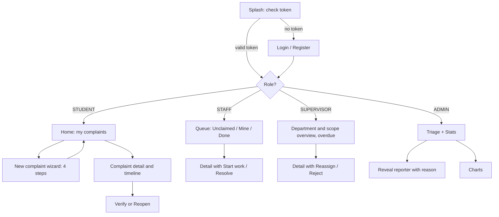

### 12.7 Design system (starting point)

| Token | Value | Use |
|---|---|---|
| Primary | deep blue `#1F3A5F` | App bars, titles, primary buttons |
| Accent | teal `#2A9D8F` | Success, links, resolved |
| Warning | orange `#E76F51` | Overdue, high severity, reopen |
| Background | `#F7F9FB` | Screens |
| Font | Inter (Google Fonts) | One family only |
| Shape and size | Material 3, 12 px rounded cards, 48 px minimum touch target, staff buttons at least 56 px high | |

**Status colours (identical everywhere):** REPORTED grey-blue, ASSIGNED blue, IN_PROGRESS amber, RESOLVED teal, VERIFIED green, REOPENED orange, REJECTED grey. Always show the word as well as the colour. Severity uses intensity of one hue, not new hues.

**UX rules that earn marks:** the staff app is boring and obvious; one primary action per screen; every list has an empty state and a skeleton; every error has a retry; the anonymity promise is stated in plain words at submit time.

### 12.8 UI/UX design and the AI tools that help

> Tool offers and limits change fast. Check each tool's current free plan before committing.

| Job | Tools to try | Notes |
|---|---|---|
| Text prompt to screens | Google Stitch, Figma AI features, Uizard, Visily, Banani | Generate 8 key screens in an hour, 2 to 3 variants of the home and detail screens only |
| Hand refine | Figma (education plan), Penpot | Final design lives here; build the six reusable components once |
| Code from design | FlutterFlow (exports Flutter), Figma-to-Flutter plugins (Locofy, DhiWise), a multimodal AI that reads a screenshot | Treat output as a draft; rewrite into the feature structure and theme |
| Web-only generators | v0, Lovable, Bolt | Output is React, not Flutter; use for inspiration only |
| Inspiration | Mobbin, Dribbble, Material 3 gallery | Search "issue tracker", "ticket timeline", "report a problem" |
| Colour, type, icons | Material Theme Builder, Coolors, Google Fonts, Material Symbols, Lucide, Phosphor | Generate the scheme from the brand blue |
| Illustration and motion | unDraw, Storyset, LottieFiles, Rive | One success animation after submit lifts the demo |

**Workflow for Yash (about 2 days spread over the first week):**

1. Collect 10 reference screens in one board.
2. Generate the **8 key screens**: login, student home, wizard step 2, wizard step 3, complaint detail with timeline, staff queue, staff detail, admin stats.
3. Pick one direction as a team on Monday. Lock tokens (12.7).
4. Build the six shared components in Figma and mirror them as Flutter widgets.
5. Test a clickable Figma prototype with three students for 15 minutes before coding the wizard.

**Prompt template:** "Design a mobile screen for Fix Loop, a campus complaint tracker. Screen: NAME. User: ROLE. Style: clean, friendly, Material 3, 12px rounded cards, lots of white space. Colours: primary 1F3A5F, accent 2A9D8F, warning E76F51, background F7F9FB. Font: Inter. Content: LIST EXACT ELEMENTS. States: loading, empty, error. Constraints: one primary action, large touch targets, phone portrait 390 by 844, no stock illustrations, no gradients." Generate one screen per prompt.

### 12.9 Flutter web specifics (admin console)

- Use a responsive layout (side navigation on wide screens, bottom navigation on narrow).
- Configure a single-page-app fallback rule on the static host so that refreshing a deep link works.
- Test the photo picker on web early; it behaves differently from Android.
- Keep admin screens table-like and simple; this is not where the beauty budget goes.

### 12.10 Testing the app (minimum viable)

Widget tests for the shared widgets (status chip shows the right word and colour), for form validation in the wizard, and for the error mapper. One manual script covers the seven demo flows on a real phone and a laptop browser. That is enough.

---

## 13. API design

Write this as an OpenAPI file **in the first two days**. It is the contract between the three tracks.

### 13.1 Conventions (agree once, follow forever)

| Topic | Rule |
|---|---|
| Base path | `/api/v1` |
| Format | JSON; UTF-8; dates in ISO-8601 UTC |
| Naming | Plural nouns for resources; verbs only for actions on a resource (`/complaints/{id}/transitions`) |
| Auth | `Authorization: Bearer <access token>` |
| IDs | UUID in paths; human `code` returned in bodies |
| Pagination | `page` (0-based) and `size` (max 50); response includes totals |
| Concurrency | Every write to a complaint carries the `version` the client saw |
| Idempotency | `Idempotency-Key` header on complaint creation |
| Files | Multipart for creating a complaint with photos |
| Errors | One shape (13.3) |
| Anonymity | No response to STAFF or SUPERVISOR ever includes reporter fields |

### 13.2 Endpoint catalogue

| Area | Method and path | Who | Purpose | Phase |
|---|---|---|---|---|
| Auth | POST `/auth/register` | Public | Student sign-up | 1 |
| Auth | POST `/auth/login` | Public | Tokens | 1 |
| Auth | POST `/auth/refresh`, `/auth/logout` | Any | Rotate, revoke | 1 |
| Auth | POST `/auth/change-password` | Any | Forced after admin-created account | 1 |
| Auth | GET `/me` | Any | Current user, role, scope | 1 |
| Reference | GET `/locations/tree`, `/categories`, `/departments` | Any | Pickers | 1 |
| Complaints | POST `/complaints` (multipart) | Student, Admin | Create with photos | 1 |
| Complaints | GET `/complaints` (filters: mine, status, department, locationId, categoryId, overdue; paging) | Role-scoped | Lists and queues | 1 |
| Complaints | GET `/complaints/{id}` | Role-scoped | Detail with timeline and attachment links | 1 |
| Complaints | GET `/complaints/similar?locationId&categoryId` | Student | Count and status only | 1 |
| Workflow | POST `/complaints/{id}/claim` body `{version}` | Staff, Supervisor | Start work | 1 |
| Workflow | POST `/complaints/{id}/release` body `{note, version}` | Staff, Supervisor | Give back | 1 |
| Workflow | POST `/complaints/{id}/resolve` (multipart: note, proof photo, version) | Staff, Supervisor | Mark resolved | 1 |
| Workflow | POST `/complaints/{id}/verify` body `{version}` | Reporter | Confirm fix | 1 |
| Workflow | POST `/complaints/{id}/reopen` body `{reason, version}` | Reporter | Not fixed | 1 |
| Workflow | POST `/complaints/{id}/reassign` body `{departmentId, userId?, note, version}` | Supervisor, Admin | Reassign | 1 |
| Workflow | POST `/complaints/{id}/reject` body `{note, version}` | Supervisor, Admin | Reject | 1 |
| Notifications | GET `/notifications`, POST `/notifications/{id}/read` | Any | Inbox | 1 |
| Admin | GET `/admin/triage` | Admin | Unrouted complaints | 1 |
| Admin | POST `/admin/complaints/{id}/reveal-reporter` body `{reason}` | Admin | Logged reveal | 1 |
| Admin | GET and POST `/admin/users` | Admin | Create staff and supervisors | 1 |
| Admin | CRUD `/admin/categories`, `/admin/locations`, `/admin/routing-rules`, `/admin/sla-policies`, `/admin/settings` | Admin | Configuration | 1 seed, 2 UI |
| Stats | GET `/stats/by-status`, `/stats/by-department`, `/stats/daily` | Supervisor (own scope), Admin | Three charts | 1 |
| Stats | GET `/stats/mttr`, `/stats/hotspots`, `/stats/department-performance` | Admin | Dashboard | 2 |
| Ops | GET `/actuator/health` | Public | Liveness | 1 |

Using named actions (`/claim`, `/resolve`) instead of one generic "change status" endpoint keeps each call small and each permission obvious. Internally they all go through the one workflow method.

### 13.3 Error contract

One shape for every error: a stable machine `code`, a human `message`, optional `details` (field errors), and a `traceId` the user can quote.

| HTTP | Code (examples) | When |
|---|---|---|
| 400 | VALIDATION_FAILED | Bad or missing field |
| 401 | UNAUTHENTICATED, TOKEN_EXPIRED | No or expired token |
| 403 | FORBIDDEN, NOT_YOUR_COMPLAINT | Wrong role or ownership |
| 404 | NOT_FOUND | Also used when a user may not know a record exists |
| 409 | VERSION_CONFLICT, ALREADY_CLAIMED | Stale version or lost the claim race |
| 422 | NOTE_REQUIRED, PHOTO_REQUIRED, PHOTO_NOT_ALLOWED, ILLEGAL_TRANSITION | Business rule broken |
| 429 | RATE_LIMITED | Too many requests |
| 5xx | INTERNAL_ERROR | Our bug; trace id logged |

### 13.4 Sample: create a complaint (shape only)

Request parts: `categoryId`, `locationId`, `severity`, `title`, `description` (optional), `shareIdentity` (optional, default false), up to three image files. Header `Idempotency-Key`.

Response 201 (to the reporter):

```json
{
  "id": "uuid",
  "code": "FL-2026-000123",
  "status": "ASSIGNED",
  "category": {"id": "uuid", "name": "AC not working"},
  "location": {"id": "uuid", "path": "Block A / Floor 2 / Room 204"},
  "severity": "MEDIUM",
  "department": {"name": "Electrical"},
  "slaDueAt": "2026-11-12T10:30:00Z",
  "version": 2,
  "createdAt": "2026-11-11T10:30:00Z"
}
```

The same complaint as seen by **STAFF** has no reporter data and no `shareIdentity` unless the reporter opted in. Design the response classes so the staff version simply has no field for it.

---

## 14. Security, privacy and abuse resistance

### 14.1 Threat model (STRIDE-lite; 40 minutes, earns marks)

| Threat | Example | Control |
|---|---|---|
| **S**poofing | Someone logs in as another user | Strong password hashing, generic login errors, rate limit, short-lived tokens |
| **T**ampering | A student edits another's complaint or skips a status | Server-side ownership checks, transitions table, version checks |
| **R**epudiation | "I never resolved that" | Append-only events with actor and time |
| **I**nformation disclosure | Staff learn who reported; photo links leak; detail pages visible to wrong roles | Reporter-free response classes, signed expiring photo links, department and scope filters, 404 for out-of-scope ids |
| **D**enial of service | Spamming complaints or logins | Rate limits, upload limits, domain allow-list |
| **E**levation of privilege | A student calls an admin endpoint | Role annotations on every endpoint, denied by default |

### 14.2 What to code for security (guidance, not code)

This is the part AI is most likely to get subtly wrong. Build it in this order and test each step:

1. **Deny by default.** Every endpoint requires authentication except login, register, refresh and health. A new endpoint is locked until you open it deliberately.
2. **Stateless tokens.** Access tokens live about 15 minutes. Refresh tokens are random, stored **hashed** in the database, rotated on every use, revoked on logout. Reusing an old refresh token revokes the whole chain.
3. **Password rules.** Hash with BCrypt; enforce a minimum length; never return or log the hash; on login failure always return the same generic message.
4. **Role checks on every endpoint** using method-level annotations, not only URL patterns. URL rules are the coarse gate, annotations the precise one.
5. **Ownership checks in the service layer.** This is the classic hole (insecure direct object reference): a user changes an id in the URL and reads someone else's complaint. For every read and write, ask "may *this user* touch *this record*?" and answer in the service, not the controller.
6. **Scoped queries.** Staff list queries always include their department; supervisor queries include department and location scope. Never filter after fetching.
7. **Response classes without reporter fields** for STAFF and SUPERVISOR (D8).
8. **CORS** restricted to the web app's origin only.
9. **Rate limiting** on login, register and complaint creation.
10. **Upload hygiene:** allow only known image types, limit size and count, re-encode on the server to strip metadata, never trust the file name or declared type, generate your own storage keys.
11. **Signed, expiring photo links.** No public bucket.
12. **Secrets in environment variables only.** No secret ever in Git; if one leaks, rotate it immediately.
13. **HTTPS only** in deployed environments.
14. **Security headers** and no stack traces in responses.
15. **Dependency hygiene:** keep the framework on a supported version; enable automated dependency alerts on the repo.

### 14.3 Controls checklist (tick in week 4, show in the report)

- [ ] Every endpoint has a role rule; unauthenticated calls to protected endpoints return 401
- [ ] Negative tests: each role calls each other role's endpoints and gets 403
- [ ] A student cannot open another student's complaint (tested with a changed id)
- [ ] Staff cannot open a complaint from another department
- [ ] Sensitive-category complaints invisible to ordinary staff
- [ ] Staff and supervisor responses contain no reporter field (automated check on JSON)
- [ ] Refresh token rotation and reuse detection tested
- [ ] Passwords never in logs; tokens never in logs
- [ ] Rate limit returns 429
- [ ] Oversized and non-image uploads rejected
- [ ] Photo links expire
- [ ] No secrets in the repository history (scan once before the demo)
- [ ] CORS locked down
- [ ] Demo-mode open signup is switched off after the demo

### 14.4 Privacy: the part that separates you from a tutorial

1. **Data minimisation:** collect only what is needed. No phone numbers, no roll numbers in Semester 1.
2. **Purpose limitation:** complaint data is used to resolve complaints and to produce aggregate statistics, nothing else.
3. **Anonymity from handlers** (4.3) with transparent limits.
4. **Photos:** warn users not to include faces or ID cards; strip metadata; disable photos for washrooms and sensitive categories.
5. **Retention** (9.7) and a way to delete a user on request (decide with the college).
6. **Honest wording:** the privacy promise in the app must say exactly what is and is not hidden.
7. **Pilot ethics (S2):** get the college's permission before real data; brief users on what is collected.

### 14.5 Abuse and moderation (questions you will be asked)

| Question | Answer |
|---|---|
| How do you stop fake complaints? | College-email gating, rate limits, admin reject, and the reveal-with-reason control for repeat abusers |
| What if someone reports another student? | Categories are about places and services; free text is moderated by supervisors; admin can reject and act |
| What if staff ignore it? | Due times, overdue lists and, in Semester 2, automatic escalation |
| What if students never verify? | Semester 2 auto-verify after N days, with a notice |
| Can an admin abuse the reveal? | It requires a reason and is logged where other admins can see it |

---

## 15. Testing and quality assurance

### 15.1 What "tested" means here

Not 100% coverage. It means: the rules that protect the loop are tested automatically, the seven demo flows have a manual script, and a teammate can run everything on a clean machine.

| Layer | What | Tool | Target |
|---|---|---|---|
| Unit | State machine, routing rules, due-time calculation | JUnit 5 | Every row of the transitions table, both allowed and forbidden |
| Integration | API plus a real Postgres | Spring Boot tests with Testcontainers | Login, create, route, claim, resolve, verify, reopen, role denials |
| Concurrency | 20 parallel claims | JUnit with threads | Exactly 1 success, 19 conflicts |
| Contract | Staff and supervisor responses never include reporter data | An automated JSON check | Zero reporter fields |
| Widget | Shared Flutter widgets, wizard validation, error mapper | `flutter_test` | Key widgets covered |
| Manual | The seven demo flows on a real phone and a browser | Checklist (Appendix C) | Passes twice in a row |
| Load sanity | List and create under seeded data | k6 or a simple script | Lists under 1 s at 1,000 rows after warm-up |

### 15.2 The five tests that will actually save your demo

1. **The claim race** (concurrency, 8.6).
2. **The illegal jump** (every forbidden transition returns an error).
3. **The anonymity check** (no reporter in staff responses).
4. **The IDOR check** (a student changes an id in the URL and gets 404 or 403).
5. **The cold-start rehearsal** (stop the server, wait for sleep, open the app, time the recovery).

### 15.3 Evaluation plan (earns the methodology marks)

| Evaluation | Method | Target | Phase |
|---|---|---|---|
| Functional correctness | Test suite and manual script | All Must requirements verified | 1 |
| Routing accuracy | Run the rule engine on 100 labelled synthetic complaints (known correct department) | At least 90% correct | 1 |
| Concurrency safety | Claim race test | Exactly one winner every run | 1 |
| Audit completeness | SQL check: every status change has an event | 100% | 1 |
| Privacy | Response inspection tests | Zero reporter leaks | 1 |
| Usability | 5 students (S1) then 15 to 20 (S2) report an issue; timed; SUS questionnaire | Under 60 s; SUS above 68 | 1 and 2 |
| Escalation timing | Controlled clock test | Fires once per level | 2 |
| Real impact | Median resolution time before and after the pilot | Report honestly, whatever it is | 2 |

### 15.4 Test and demo data

1. **Survey** (see 21.5): baseline for how people report and wait.
2. **Synthetic complaints:** 500 to 1,000 rows generated with SQL or a small script, using the real categories and locations and realistic phrases; 100 are labelled for the routing test. Label it as synthetic in the report.
3. **Pilot data** (S2).

### 15.5 Continuous evaluation (25%): the cheapest marks in the course

The mentor grades participation, demonstration and viva. Make that easy: a weekly report on time, a short demo of whatever works each week, a visible commit history from all three, and a quick teach-back when asked. Appendix D has the template.

---

## 16. DevOps, environments and demo-day operations

### 16.1 Repository layout (monorepo, LOCKED)

```text
fixloop/
  README.md                how to run everything in 10 minutes
  AI_USAGE.md              what AI helped with, and who verified it
  docker-compose.yml       postgres, minio, mailpit, api (local)
  .env.example             variable NAMES only, no values
  .github/workflows/       ci.yml (build and test), deploy.yml (later)
  docs/
    bible/                 this document (md and docx)
    openapi/               API contract
    adr/                   decision records
    weekly/                weekly notes (W44, W45 ...)
    design/                exported screens, tokens
    report/                report drafts
  apps/
    api/                   Spring Boot
    mobile/                Flutter (Android and web)
  infra/
    seed/                  reference data and reset script
    deploy/                platform notes and runbooks
  data/
    synthetic/             generator and the labelled routing test set
```

### 16.2 Branching and review (3 people, 5 weeks: keep it boring)

- `main` is always runnable and is what gets deployed.
- Short-lived branches named by track and topic (for example `a/routing-rules`, `b/wizard-step2`, `c/ci-pipeline`).
- Every merge is a pull request with one reviewer and a green CI run. The description has the **teach-back three lines**: what it does, how it works, what could break.
- Small pull requests (under about 300 changed lines). Review within 24 hours.
- Commit messages say what and why. No force pushes to `main`.
- Database changes only as new migration files; never edit an applied migration.

### 16.3 Local development: three steps (everyone, on day one)

1. Clone the repo and copy `.env.example` to `.env`.
2. Start the infrastructure with Docker Compose (database, object storage, email catcher).
3. Run the API (Swagger UI opens) and run the Flutter app on an emulator, the phone and Chrome.

If a teammate cannot do this in 10 minutes, fixing the README is the next task for the owner of the failing step.

### 16.4 Continuous integration: the shape

| Stage | What runs | Fails the build when |
|---|---|---|
| API | Build, unit tests, integration tests with a temporary Postgres | Any test fails |
| Mobile | Static analysis, widget tests | Analysis errors or test fails |
| Hygiene | Secret scan, dependency alerts | A secret pattern is found |
| Image | Build the API container image | Build error |

Deployment (Plan A) is triggered from `main` after CI passes, then a health check confirms it is live.

### 16.5 Environments

| Environment | Purpose | Data | Where |
|---|---|---|---|
| **Local** | Daily work | Seed data | Your laptop with Docker Compose |
| **Test** | Automated tests | Temporary containers | CI |
| **Demo** | The public deployment for mentor, panel and testers | Seed plus synthetic; clearly labelled | Plan A (or Plan B) |
| **Pilot** (S2) | Real users | Real | Plan B or college server |

Never test on the demo environment during the last 24 hours before a presentation.

### 16.6 Environment variables (names only; real values never in Git)

| Name | Meaning |
|---|---|
| DATABASE_URL, DATABASE_USER, DATABASE_PASSWORD | Postgres connection (use the pooled string on Supabase) |
| JWT_SECRET | Signing secret for access tokens (long, random) |
| JWT_ACCESS_MINUTES, JWT_REFRESH_DAYS | Token lifetimes |
| STORAGE_ENDPOINT, STORAGE_BUCKET, STORAGE_ACCESS_KEY, STORAGE_SECRET_KEY | Object storage |
| SIGNED_URL_MINUTES | Photo link expiry |
| ALLOWED_ORIGINS | CORS: the web app URL |
| ALLOWED_EMAIL_DOMAINS | Fallback if the settings table is empty |
| SMTP_HOST, SMTP_PORT, SMTP_USER, SMTP_PASSWORD, MAIL_FROM | Email |
| JAVA_OPTS | Heap limits for the small free instance |
| SPRING_PROFILES_ACTIVE | dev, test, prod |
| SEED_ADMIN_EMAIL, SEED_ADMIN_PASSWORD | First admin for a fresh database |

### 16.7 Plan A deployment runbook (do this early, in Week 1)

Deploy an empty-but-healthy system in Week 1. A deployment you meet for the first time in Week 4 will fail in a new way.

1. **Database:** create the Supabase project; note the pooled connection string; confirm it accepts connections from outside.
2. **Storage:** create a private bucket; create access keys.
3. **API:** create the web service from the repo's container build; set every environment variable from 16.6; set the memory-limiting Java options; set the health check path.
4. **First deploy:** open the health URL; confirm the migrations ran; confirm login against the seeded admin.
5. **Web app:** build the Flutter web bundle, publish it to the static host, add the SPA fallback rule, set `ALLOWED_ORIGINS` on the API.
6. **APK:** build the release APK, attach it to a GitHub Release, write the install note ("allow installs from this source").
7. **Keep-alive:** create an uptime monitor on the health URL; make the health check also touch the database so the free database does not pause.
8. **Record the URL, the admin login and the rollback steps** in `infra/deploy/` (without secrets).

**Rollback:** keep the previous image tag; redeploying it is the rollback. Practise it once.

### 16.8 Demo-day operations (this is 40% of your grade: treat it like a deploy)

**T minus 24 hours:** feature freeze since 20 Nov; no migrations; reset the demo data with the seed script; test on the actual projector and Wi-Fi if possible; charge phones; build the final APK; record a backup video of the full loop.

**T minus 30 minutes:** warm up the API and database (open the app, log in, create and delete a test complaint); check both phones are logged in as the right roles; open the browser tabs; hotspot ready; local Docker fallback laptop running.

**During:** one person drives, one narrates, one watches the logs and clock. If the cloud fails, say so calmly and switch to the local laptop; if that fails, play the video.

**After:** switch off demo-mode open signup; export the database; keep the environment for the mentor.

### 16.9 Backups and restore (20 minutes, do it once)

Export the database weekly (a full dump file) and store it outside the hosting provider. Once, in Week 3, **restore it into a fresh local database** to prove the backup works. A backup you have never restored is a hope.

---

## 17. Delivery plan, Semester 1 (24 Oct to 28 Nov 2026)

### 17.1 The weekend sprint and the Monday pack (Sat 24 to Mon 26 Oct)

The mentor wants, on Monday: **base fundamental code set up, architecture decided, debated screens and how the app will look, visible progress.** This is the Monday pack.

**What to show on Monday**

| # | Item | Proof |
|---|---|---|
| 1 | Problem, objectives, scope and decision register | Sections 1, 3 and 0.2 |
| 2 | Architecture decided | Context and container diagrams, one-page stack table |
| 3 | Data model decided | ER diagram, state machine, table list |
| 4 | Plan and ownership | Track split, week-by-week plan, capacity math |
| 5 | **Base code set up** | A repo with the layout in 16.1, a README, CI green, the API starting and answering its health URL, the database starting in Docker, the Flutter app opening on a login screen |
| 6 | **How the app will look** | 8 key screens as a clickable Figma or generated prototype, plus the tokens |
| 7 | Questions for the mentor | List in 17.2 |

**Weekend task list**

| Person | Saturday and Sunday | Monday morning |
|---|---|---|
| **Dushyant** (about 8 h) | Ratify the decision register with the team; draft the OpenAPI outline for auth, directory and complaints; draft seed lists (departments, categories, a first pass at locations from memory, to be corrected on a campus walk); create the Spring Boot project skeleton with health endpoint and Swagger UI (pair with Dev) | Assemble the Monday pack; rehearse the architecture explanation |
| **Yash** (about 8 h) | Install Flutter on the Mac and an Android device; do the first half of the Flutter ramp (Dart basics, widgets); collect 10 reference screens; generate the 8 key screens and pick a direction; build the Figma file with tokens; scaffold the Flutter app with theme and a fake login screen | Present the screens; capture feedback |
| **Dev** (about 8 h) | Create the GitHub repo and layout; write README and `.env.example`; Docker Compose with Postgres, MinIO and Mailpit; CI pipeline that builds and tests; verify the Student Pack and Azure-for-Students eligibility; create Supabase and Render accounts; ask whether student emails are on `bmu.edu.in` and whether verification mail arrives | Show CI green and Docker up |
| **Everyone** | Read Sections 1 to 4, 8 and 9; draft Weekly report 1 (Appendix D) | Send the report to the mentor |

### 17.2 Questions for the mentor on Monday

1. Is switching to Flutter acceptable given the approved mid-term deck (which said React)?
2. Does the college already have a grievance or ragging committee we should route to rather than replace?
3. Can the department or mentor help us meet the maintenance office, the warden and the estate officer?
4. What is the exact end-sem date, and what must the demo include and how is the report formatted?
5. Can the department give us a server for the Semester 2 pilot?
6. Are the college email domain and a sender address for verification mail available to us?

### 17.3 Five weeks, week by week

| Week | Dates | Theme | Goal | Exit criteria (checked honestly each Sunday) |
|---|---|---|---|---|
| **0** | Sat 24 to Mon 26 Oct | Align | Monday pack | Mentor review done; repo, CI, Docker, health endpoint, Flutter login shell, 8 screens |
| **1** | Tue 27 Oct to Sun 1 Nov | Walking skeleton | Everything exists, everything is public, nothing is pretty | **G1:** deployed API health URL is public; migrations create the core tables on Supabase; register and login work against the deployed API; Flutter login talks to the real API; OpenAPI v1 agreed; the 3-day Flutter ramp done; ADR-002 check passed; survey form published |
| **2** | Mon 2 to Sun 8 Nov | Intake and routing | A complaint can be created and routed | **G2:** seeded locations, categories, departments and rules; create complaint (with photo) end to end; routing assigns a department from rules; student home list and wizard work; staff queue shows the right complaints; flows F1 to F3 on the public deployment |
| **3** | Mon 9 to Sun 15 Nov | Close the loop | The full loop works | **G3:** claim (race test green), resolve with proof, verify and reopen, timeline; supervisor reassign and reject; in-app notifications; APK built; web build live; **F1 to F6 on the public deployment; mentor sees a live demo**; backup restored once |
| **4** | Mon 16 to Sun 22 Nov | Harden | Freeze, test, polish | **G4 (Fri 20 Nov: FEATURE FREEZE):** all Must done; F7 works; SLA due and overdue badge; three charts; 500+ synthetic complaints loaded; routing accuracy measured; security checklist ticked; test suite green in CI; known-bugs list written. Dress rehearsal 1 on Sunday |
| **5** | Mon 23 to Fri 27 Nov | Deliver | Report, rehearsal, resilience | **G5:** report submitted; slides final; rehearsal 2 on Wednesday (timed); backup video; fallback laptop works; warm-up routine practised; demo mode on and tested. Friday is a spare day. Deadline around Sat 28 Nov |

If the semester calendar moves the end-sem date, **slide the weeks but keep the freeze two weeks before the presentation.**

### 17.4 Gates: go or no-go, written down

| Gate | Date | Question | If the answer is no |
|---|---|---|---|
| G0 | Mon 26 Oct | Did the mentor accept the architecture and plan? | Fix the objection before building |
| G1 | Sun 1 Nov | Can we deploy, log in and migrate on the public stack? | Apply ADR-002 (switch backend) and/or Plan B hosting; no further options |
| G2 | Sun 8 Nov | Does intake and routing work end to end? | Cut ladder steps 5 to 7; add a second weekend session |
| G3 | Sun 15 Nov | Does F1 to F6 work in public? | Cut ladder steps 1 to 4; two pair-programming sessions per person |
| G4 | Fri 20 Nov | Are all Must items done and tested? | Cut everything that is not Must; start the report in parallel |
| G5 | Wed 25 Nov | Did a timed rehearsal succeed on the public stack and the fallback? | Fix only demo-critical bugs; no new work |

### 17.5 Semester 1 Gantt

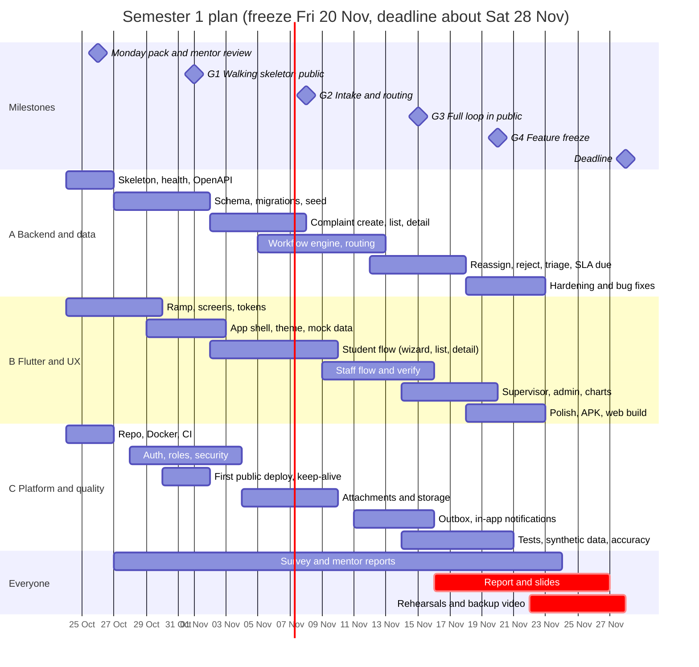

### 17.6 Who does what, per person (Semester 1 task list)

**Dushyant (Track A)**

1. Draft OpenAPI and ratify it with the team (Sat to Mon).
2. Write migrations for all tables in 9.4 and the seed data (Week 1).
3. Complaint create, list, detail, similar-count endpoints (Week 2).
4. Workflow engine with the transitions table, event writing and outbox writing (Weeks 2 and 3).
5. Routing engine and the 100-row accuracy test (Weeks 2 and 3).
6. Reassign, reject, triage, reveal reporter, SLA due date, three stats views (Weeks 3 and 4).
7. Campus walk for the real location tree; meetings with maintenance office, warden (Weeks 1 and 2).

**Yash (Track B)**

1. Flutter ramp, tokens, 8 key screens, Figma prototype (Sat to Mon).
2. App shell, theme, shared widgets, mock repository (Week 1).
3. Student wizard, my complaints, detail with timeline (Week 2).
4. Staff queue, detail actions, verify and reopen sheets (Week 3).
5. Supervisor and admin screens, three charts, notification inbox (Week 4).
6. Photo picking and compression, error mapping, cold-start screen, accessibility pass (Weeks 3 and 4).
7. Hallway usability test with 5 students (Week 4); APK and web build (Weeks 3 to 5).
8. Slides design (Week 5).

**Dev (Track C)**

1. Repo, README, Docker Compose, CI (Sat to Mon).
2. Auth, refresh tokens, roles, rate limiting, security tests (Weeks 1 and 2); pair with Dushyant.
3. First public deploy and keep-alive (Week 1); runbook (Week 1).
4. Attachments: validation, metadata stripping, storage, signed links (Weeks 2 and 3).
5. Outbox writer, dispatcher, in-app inbox endpoints (Weeks 3 and 4).
6. Tests: concurrency, anonymity, IDOR, transitions, synthetic data generator (Weeks 3 and 4).
7. Weekly reports, survey form and analysis, report assembly, user manual (Weeks 1 to 5).
8. Backups and restore (Week 3).

### 17.7 The survey (you have not run one yet; run it this week)

Publish a short form to 30 or more students by Sunday 1 Nov, close it around Sunday 8 Nov. Questions: Have you faced a campus problem this semester? What kind? How did you report it (or why not)? Was it fixed? How long did it take? Did you hear any update? Would you report anonymously? What would stop you from using an app? Also spend 20 minutes with the maintenance office, the warden and the estate officer: how do complaints reach them today, what do they use, what is the usual fix time, and what would make them use a new tool? Use the numbers on slides and in the report.

**Careful wording:** you believe nothing like this exists; say "no end-to-end tracked system that we found" until you have checked what the ERP offers.

---

## 18. Ways of working, AI usage and learning plan

### 18.1 Definition of Done (apply to every ticket)

- [ ] It works on a fresh clone with Docker Compose
- [ ] It has the relevant tests, and CI is green
- [ ] The OpenAPI file and README reflect it
- [ ] The author can explain it with no AI open
- [ ] A teammate reviewed it
- [ ] The weekly note mentions it

### 18.2 Rules that prevent 90% of team friction

1. One owner per ticket; no ticket without a requirement ID.
2. Reply in 24 hours; "busy until Wednesday" is a valid reply.
3. Disagree in writing, decide, commit.
4. No big-bang merges; small pull requests daily.
5. Nobody silently rewrites someone else's module; propose in the pull request.
6. The Sunday review is honest: red is a colour we are allowed to use.
7. Anyone who finishes early helps the person with the biggest red item.

### 18.3 Using AI without losing the plot (LOCKED, D16)

**Where AI is great here:** scaffolding the project, writing boilerplate, Docker and CI files, test cases, explaining errors, generating seed data, drafting documentation, translating a screenshot into a widget layout.

**Where AI is risky here:**

| Risk | Why it matters | Defence |
|---|---|---|
| Outdated or invented framework usage | Spring Security and Flutter APIs changed across versions | Tell the AI the exact versions; run it; read the official docs for anything security-related |
| Missing authorisation checks | It builds "login works" and forgets "this user may not see that record" | Write the denial tests first (Section 14.3) |
| Unsafe defaults | Open CORS, long-lived tokens, verbose errors | Use the Section 14.2 list as a review checklist |
| Over-engineering | Layers and patterns you cannot explain | Reject anything that is not in the module layout of 8.4 |
| Leaking secrets or real data | Pasting keys or student data into a tool | Never; use fake data |

**The rules**

1. **Never merged unread.** The author reads every line and can explain it.
2. **Prompt with context:** paste the relevant bible section (for example the transitions table or the security list) and the exact versions in use, and ask for *one small piece at a time*.
3. **Ask for explanations and alternatives**, not only code: "why this approach; what breaks under concurrency; what would you test?"
4. **Teach-back in every pull request** (three lines).
5. **Log it** in `AI_USAGE.md`: date, who, what for, what was changed afterwards.
6. **Disclose** AI assistance to the mentor and in the report's method section. What you are graded on is your design decisions, integration, testing and results.
7. **Fixing beats generating:** when AI output fails, use the error to learn; do not paste the error back endlessly. After two failed rounds, stop and read the docs.

**Can AI write the Spring Security and deployment pieces?** Yes, for a first draft: the security configuration, token handling, password hashing, role annotations, Dockerfile, Compose file, CI pipeline and deployment steps. The human work is: pinning versions, writing the denial tests, reading the result against 14.2, creating the provider accounts, setting environment variables, tuning memory, and debugging the first real deploy. Plan the deploy as a Week-1 task so the surprises come early.

### 18.4 Learning plan: the 3-day ramp (before feature work)

All three of you are new to Flutter; Docker is new to all; Spring is rusty for two. Do this in the first week, in small blocks, and count it in the effort budget (E15, 15 hours).

| Block | Who | Topic | Output |
|---|---|---|---|
| 1 | Everyone | Dart language basics: types, null safety, collections, async and futures | Tiny console exercises |
| 2 | Everyone | Flutter basics: widgets, layout, state, navigation, forms | A three-screen toy app |
| 3 | Yash and Dushyant | State with Riverpod; HTTP with dio; JSON models | The toy app lists items from a public sample API |
| 4 | Yash | Images: picker, compression; web differences | Photo selected and previewed on Android and web |
| 5 | Dev | Docker and Compose basics: images, containers, volumes, networks | Compose runs Postgres and MinIO |
| 6 | Dev and Dushyant | Spring Boot refresher: controllers, services, repositories, validation; then Spring Security: filters, authentication, authorisation, method security | A secured hello endpoint with two roles |
| 7 | Everyone | Flyway migrations, Testcontainers | One migration and one integration test |

**Rule:** by Sunday 1 Nov each person has shown a teammate their toy output. Use official documentation and the framework's own tutorials first; use AI to explain what you do not understand, not to skip the learning.

### 18.5 Reading list (about 6 hours total, in this order)

1. The official Dart language tour (skim).
2. The official Flutter "first app" and layout guides.
3. Riverpod's getting-started guide.
4. The Spring Boot reference "getting started" and the Spring Security architecture overview.
5. Flyway's concepts page.
6. Docker's "get started" and Compose overview.
7. One article on the transactional outbox pattern.
8. One article on optimistic locking.

---

## 19. Semester 2: Project-II (Jan to May 2027)

**Assumption:** Project-II runs about January to May 2027 with its own handout, mentor and dates. Confirm when released and slide the plan; the order of work stays.

### 19.1 What changes

Semester 1 proves the loop works. Semester 2 proves it is **accountable and used**: deadlines with automatic escalation, real notifications, analytics, and a campus pilot with measured impact. The research gap in the deck rests on those three claims, so they are never cut.

### 19.2 Milestones

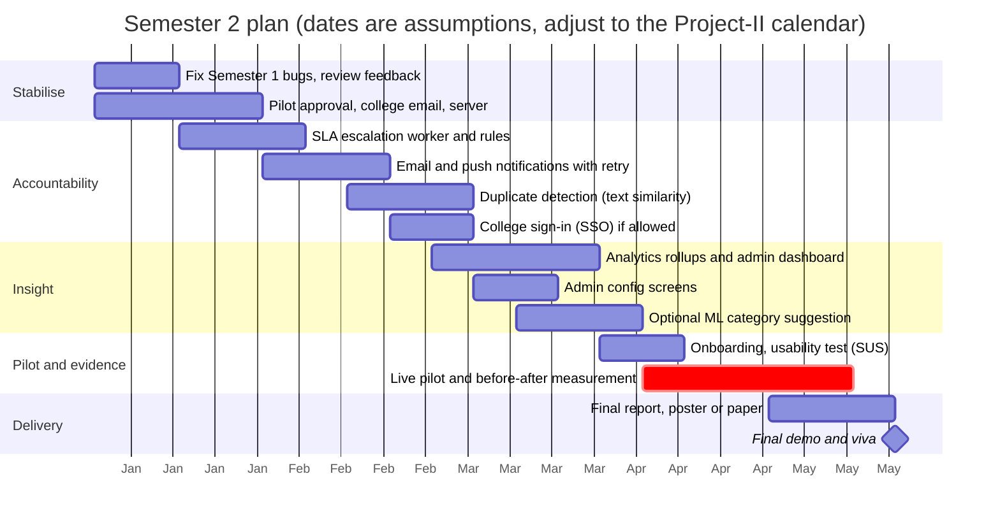

| Block | Goals | Exit criteria |
|---|---|---|
| Stabilise (Jan) | Fix known bugs; secure pilot approval; decide the permanent host (Plan B or college VM) | Zero known critical bugs; written approval or a named college contact; hosting final |
| Accountability (Jan to Feb) | Escalation worker (FR-903); email and push (FR-804, FR-805); duplicate detection; SSO if allowed | Escalation fires exactly once per level in a controlled-clock test; a killed worker loses nothing; duplicate detection measured on a labelled pair set |
| Insight (Mar) | MTTR, hotspots, department performance (FR-1004); nightly views; admin charts; admin config screens (FR-1005) | The dashboard answers "which places break most" and "which department is slowest" on pilot-like data |
| Pilot (Mar to Apr) | Onboard staff and a student group; SUS test with 15 to 20; run live 4 to 5 weeks | A few hundred real or realistically seeded complaints; adoption measured; before and after comparison |
| Delivery (Apr to May) | Report, demo, poster | Report submitted; demo rehearsed; results backed by data |

### 19.3 Optional track: the ML work, scoped honestly

Only if everything else is on track. Train a TF-IDF plus linear classifier on survey and pilot text to **suggest** a category while the student types; the student can override. Run it as a small Python service or an exported model. Report accuracy on a held-out set and say plainly it is a hint. This matches the deck's promise without overclaiming.

### 19.4 If Semester 2 is at risk, cut in this order

1. ML suggestion. 2. Working-hours SLA calendar and auto-verify. 3. SSO. 4. Push notifications (keep email and in-app).

**Never cut:** escalation, analytics, the pilot.

### 19.5 What to prepare for the Project-II report from now

Keep the weekly notes, survey data, the ADRs, the failure-mode table, test results and screenshots. A report is mostly assembly if you wrote things down as you went.

---

## 20. Risk register

L likelihood, I impact: H, M, L.

| # | Risk | L | I | Mitigation | Owner |
|---|---|---|---|---|---|
| R1 | Not enough time (about 165 hours for everything) | H | H | Vertical slice, Must list, cut ladder, freeze 20 Nov, weekend sprint | Dushyant |
| R2 | Flutter learning curve (all new) | H | H | 3-day ramp, mock-first, one hallway test in Week 1, PWA fallback | Yash |
| R3 | Spring Security and migration setup eats Week 1 | M | H | Pair Dev and Dushyant; ADR-002 check on 1 Nov | Dev |
| R4 | Free API host sleeps or runs out of memory (JVM) | H | M | Heap limits, keep-alive, warm-up, local fallback, Plan B | Dev |
| R5 | Free database pauses or hits limits | M | H | Health check touches DB, calendar reminder, backups | Dev |
| R6 | Photo upload on Flutter web misbehaves | M | M | Test in Week 1; fall back to Android-only photos | Yash |
| R7 | AI-generated code nobody understands | M | H | Teach-back, weekly swap, AI_USAGE.md | All |
| R8 | Integration surprises late | M | H | Contract first, 1 Nov integration, deploy in Week 1 | Dushyant |
| R9 | Broken `main` or merge conflicts | M | M | Branches, CI, reviews, separate folders per track | Dushyant |
| R10 | Staff will not use it | M | H | Involve the maintenance office now; staff UI with few taps; Semester 2 pilot measures adoption | Yash |
| R11 | Privacy failure (reporter leaked) | L | H | Response classes without the field, automated JSON check, reveal logging | Dev |
| R12 | Demo failure on the day | M | H | Two environments, reset script, backup video, two rehearsals | Dev |
| R13 | College email or verification unavailable | M | M | Domain allow-list without verification; demo-mode open signup | Dev |
| R14 | Student Pack or Azure eligibility fails | M | M | Plan A needs neither; apply early | Dev |
| R15 | Scope creep (social features, ML) | M | M | D9, D11; cut ladder; "not in the bible" rule | All |
| R16 | Teammate unavailable (exams, illness) | M | M | Cross-training swaps, small pull requests, notes | All |
| R17 | Overclaiming in the viva | L | M | Honest framing (3.5, 4.3) | All |
| R18 | Mentor expects different scope | L | H | Monday review, weekly reports | Dushyant |

---

## 21. Documentation, report and viva

### 21.1 What the end-sem panel scores and our evidence

| Criterion | Our evidence |
|---|---|
| Project understanding | Problem, survey numbers, this bible |
| Research and literature | Mid-term deck areas A to D, research gap, comparison table |
| Methodology and approach | State machine, config-driven rules, architecture, two-phase plan |
| Implementation and execution | **A working public demo** of the full loop |
| Results and analysis | Routing accuracy, concurrency proof, anonymity tests, usability results |
| Innovation and creativity | Integrated closed loop, config-driven rules, anonymous-by-default design |
| Documentation and presentation | Report, README, OpenAPI, user manual, slides |
| Critical thinking | ADRs, trade-offs, failure-mode table, risk register |
| Teamwork | Git history by all three, clear ownership, rehearsed handovers |
| Overall contribution and impact | Pilot plan, before and after metrics plan |

### 21.2 Report outline (10% of the grade, last week of November)

| Chapter | Content | Source |
|---|---|---|
| 1. Introduction | Motivation, problem, objectives, scope | Deck slides 2 to 4, Section 1 |
| 2. Literature review | Four areas, comparison table | Deck slides 5 to 9 and 14 |
| 3. Research gap | Four gaps and the closing line | Deck slide 10 |
| 4. Requirements | Roles, requirements, NFRs | Sections 4 to 6 |
| 5. System design | Architecture, data model, workflow, routing, anonymity, security | Sections 8 to 10, 14 |
| 6. Implementation | Stack, key walkthroughs, screenshots, challenges, how AI was used | Your build, Section 18.3 |
| 7. Testing and results | Test plan, results, routing accuracy, concurrency proof, privacy tests | Section 15 |
| 8. Deployment | Environments, hosting under zero budget, runbook, demo-day operations | Sections 7.5, 16 |
| 9. Conclusion and Phase 2 | What works, limits, next semester | Sections 3 and 19 |
| References | IEEE style; only what you read | Deck references, fixed |
| Appendices | OpenAPI export, ER diagram, test cases, user manual | |

**Reference hygiene:** the deck's notes flag that one SeeClickFix paper fits Area D better than Area A, that one source is a light descriptive study, and that one is a preprint. Fix those before the report, and verify every comparison-table tick against official documentation.

### 21.3 User manual (CO4 asks for it): 8 pages, no more

Getting the app (web link and APK, the install note); registering; reporting a problem (with screenshots); what anonymous means; tracking and verifying or reopening; staff guide (queue, start, resolve); supervisor guide; admin guide (triage, reveal with reason); troubleshooting ("the app is waking up"); contact and privacy statement.

### 21.4 Viva question bank (prepare two-line answers)

**Problem and scope**

1. Why not WhatsApp or the ERP? *No tracking, routing, accountability or analytics; the ERP records complaints but does not route, escalate, verify or analyse (confirm what yours offers).*
2. How is this different from Jira or Freshdesk? *General-purpose and costly, not student-facing, no campus location tree, no anonymity, not config-driven for a campus.*
3. Where is the ML? *Section 3.5.*
4. What is novel? *The integrated, config-driven, closed-loop workflow for a campus with anonymous reporting and recurrence analytics.*

**Design**

5. Why a state machine in a table? *One place to read, test and change; illegal jumps impossible.*
6. How does routing choose a department? *First matching rule by priority; fallback to triage.*
7. What if no rule matches? *Admin Triage plus an event.*
8. How do you stop two staff claiming the same job? *Optimistic locking; one wins, the other gets 409.*
9. Why append-only events? *Audit, analytics, no silent changes.*
10. What is the outbox pattern and why? *Notifications commit with the change, sent later; survives crashes.*
11. How does the SLA escalation avoid double firing? *Stored due times, row locks, level counter.*
12. Why a modular monolith? *Three people, five weeks; modules can split later.*

**Privacy and security**

13. How is the reporter hidden? *Response classes for staff have no reporter field; tested automatically.*
14. Can anyone see the reporter? *Admin only, with a reason, logged.*
15. Is it truly anonymous? *From handlers, not from the system administrator; we say so openly.*
16. How do you prevent a student reading another's complaint? *Ownership checks in the service layer plus tests with changed ids.*
17. How are passwords and tokens handled? *Hashed passwords, short-lived access tokens, hashed rotating refresh tokens.*
18. How do you handle harassment complaints? *Sensitive categories route only to restricted departments; ordinary staff cannot see them.*
19. How do you stop spam? *Domain allow-list, rate limits, admin reject.*

**Engineering and delivery**

20. Why Flutter? *Section 7.2.*
21. Why Spring Boot? *Section 7.3.*
22. How did you deploy for free and what are the limits? *Plan A free tiers, keep-alive, warm-up, fallback; Plan B VM.*
23. How did you use AI? *Scaffolding and tests; never merged unread; logged; here is a module I wrote and can explain.*
24. What did you test and how? *Section 15.2.*
25. What would you do with more time? *Section 19.*
26. What went wrong and what did you learn? *Have one honest story ready (for example the cold start).*

### 21.5 The survey and fieldwork

See 17.7. Record number of respondents, key percentages (how people report today, how long fixes take, whether they would report anonymously) and quotes from the maintenance office. These numbers appear on slide 2 and in chapter 1.

### 21.6 References: the rule that keeps you safe

Cite only what you actually read. Every claim in the comparison table must be traceable to a source. IEEE style, numbered, in the order cited. Include official documentation for any product you mention.

---

## 22. Appendices

### A. Glossary (use these words consistently in the app and the report)

| Term | Meaning |
|---|---|
| Complaint | A reported problem; the app may label it "issue" in friendly text |
| Reporter | The person who filed it (hidden from handlers by default) |
| Handler | Anyone who works or oversees a complaint |
| Department | A team that fixes things (for example Electrical) |
| Scope | The department or location subtree a supervisor oversees |
| Routing | Choosing the department automatically |
| Claim | A staff member taking ownership (Start work) |
| Due time (SLA) | The target time to resolve |
| Escalation | Automatic action when the due time passes (Semester 2) |
| Verification | The reporter confirming the fix |
| Reopen | The reporter saying it is not fixed |
| Triage | Admin handling of complaints that routing could not place |
| Reveal | Admin looking up the reporter, with a reason, logged |
| Event | One immutable row in the complaint's history |
| Outbox | Table of messages waiting to be sent |
| Version | Counter used to detect conflicting updates |
| MoSCoW | Must, Should, Could, Won't |
| MTTR | Mean time to resolution |
| ADR | Architecture decision record |
| Demo spine | The seven flows that must work |

### B. Handy command areas (names only; use the official docs for the exact commands)

Docker and Compose: start, stop, rebuild, view logs, reset volumes. Git: branch, rebase, resolve a conflict, tag a release. Flutter: run on a device, run on Chrome, build web, build APK, run tests, analyse. Build tool: run, test. Database client: connect, list tables, run a migration check.

### C. Manual demo script (run twice before any presentation)

1. Open the web app; show the loading screen and the log in as a student on the phone.
2. Report: category, location, severity, photo, send; read the code and due time.
3. Log in as Staff on two phones; both open the same complaint; both tap Start work; one wins, the other sees "already taken".
4. The winner resolves with a note and a proof photo.
5. The student opens the notification and taps Not fixed with a reason; confirm it returns to the queue.
6. Staff resolves again; the student taps Fixed; status is Verified.
7. Supervisor: overdue list; reassign one complaint.
8. Admin: triage list; reveal a reporter with a reason; show the event.
9. Show the timeline of a complaint (every step, who by role, when).
10. Change a routing rule in the database; report again; show it lands in a different department.
11. Show the three charts.

### D. Weekly report template (send to the mentor; keep in `docs/weekly/`)

**Week N, dates. One-line status.**

1. **Shipped this week** (3 to 6 bullets, each linked to a requirement ID or a pull request).
2. **Broke or fixed** (one honest line each).
3. **Numbers** (tests passing, endpoints done, screens done, hours spent per person).
4. **Learned** (one sentence per person).
5. **Blocked or needs from the mentor.**
6. **Next week** (goal and exit criteria from Section 17.3).
7. **Who did what** (one line per person, so individual contribution is visible).

### E. What "good" looks like on demo day

A stranger opens a link, signs up, reports a real broken thing with a photo in under a minute, sees it appear in the right queue, watches a staff phone pick it up, and verifies the fix. The panel then watches you change one database row and see the system behave differently. Nobody on the team says "it worked yesterday".

---

## 23. Open questions and change log

### 23.1 Open questions (owner and date)

| # | Question | Owner | By |
|---|---|---|---|
| Q1 | Do student emails use `bmu.edu.in`, and does verification mail arrive? | Dev | Wed 28 Oct |
| Q2 | Exact end-sem date, demo format, report template | Dushyant | Mon 26 Oct |
| Q3 | Is a grievance or ragging committee already in place? | Dushyant | Mon 26 Oct |
| Q4 | Real campus locations: blocks, floors, hostels, washrooms, canteens | Dushyant | Sun 1 Nov |
| Q5 | Real department list and who the supervisors and wardens are | Dushyant | Sun 1 Nov |
| Q6 | Realistic fix times for SLA numbers (maintenance office) | Dev | Sun 8 Nov |
| Q7 | What does the existing ERP offer, if anything? | Yash | Sun 1 Nov |
| Q8 | Student Pack and Azure-for-Students eligibility and what they include today | Dev | Wed 28 Oct |
| Q9 | Does the web app need to be reachable off campus? (Assume yes.) | All | Mon 26 Oct |
| Q10 | Retention and deletion rules the college expects | Dushyant | Semester 2 |
| Q11 | Should the wizard offer a "report on behalf of someone" option? | Yash | Sun 8 Nov |
| Q12 | Which timezone and calendar for due times: 24x7 or working hours? | All | Sun 8 Nov |

### 23.2 How to iterate this bible

1. Anyone can propose a change in a pull request; the owner of the section approves; bump the version.
2. Every **LOCKED** change needs a line in Section 11 with the reason.
3. After each Sunday review, update decision statuses, the exit-criteria table and the open questions.
4. Keep the `.md` as the master; regenerate the `.docx` when the team agrees.

### 23.3 Change log

| Version | Date | Change |
|---|---|---|
| 0.1 | 23 Oct 2026 | First Claude Doc draft |
| 0.2 | 24 Oct 2026 | Rebuilt as a full bible: team reality and capacity, anonymity design, sensitive complaints, zero-budget hosting, 5-week plan with gates, monday pack, risk register, viva bank. No real code |
